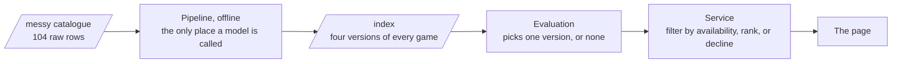

# because-you-played

"Because you played X, you might like…": a related-games recommender over a fictional catalogue of 100 slot games, built as a take-home engineering assessment. A model enriches thin catalogue records offline, an evaluation decides whether the result may be served, and the service answers from memory with no model call.

**After `npm install` it runs with no API key and no network.** The model responses it needs are stored in the repository, and the evaluation and the service replay them. Node 24 runs the TypeScript as it is. The page is the one thing that is bundled, and its bundle is committed, so there is nothing to build before running; a test fails if the committed bundle is not what the source builds ([how](docs/features/interface.md#code-and-how-it-is-built)).

```sh
npm install
npm run eval     # scores four versions of the index against pass marks fixed in advance
npm run serve    # http://127.0.0.1:8787, with the page at /
```



| To read | Where |
|---|---|
| Why it is built this way, the alternatives, how it fails and scales | [`docs/adr/0001-offline-enrichment-in-memory-serving.md`](docs/adr/0001-offline-enrichment-in-memory-serving.md) |
| The reusable artifact: nine pieces that start the next repository | [`docs/starter-kit.md`](docs/starter-kit.md) |
| The briefs given to the agents, and three explainer pages | [`docs/process/`](docs/process/README.md) |
| A two-minute walkthrough | **To be added by the owner: link to the recording** |
| The page: its four sections, the seven examples and their addresses | [`docs/features/interface.md`](docs/features/interface.md#starting-it-and-the-examples) |

## Run, evaluate, regenerate

Three separate things. The first two need no key.

### 1. Run it (no key)

```sh
git clone https://github.com/AndriiPasternak31/because-you-played.git
cd because-you-played
npm install
npm run typecheck
npm test
npm run eval
npm run serve
```

Then, in a second terminal:

```sh
curl 'http://127.0.0.1:8787/api/recommendations?game=okk-50023&brand=tavrenmoor'
```

Or open <http://127.0.0.1:8787/> for the page: four sections switched from the top, and **Examples** at the top right. If port 8787 is taken: `npm run serve -- --port 9000`.

| Try | Request | Answer |
|---|---|---|
| A normal result | `game=okk-50023&brand=tavrenmoor` | Five games, each live on that brand. The fifth is on the evaluation's list of real failures: the answer key calls it unrelated to this game |
| The same, with every step shown | add `&trace=1` | The record, each label with its quote, what each filter removed, every score against the floor |
| A game that is not live on the brand | `game=drw-12933&brand=copperjay` | Declined: `anchor_not_available` |
| A record with almost nothing in it | `game=okk-43364&brand=tavrenmoor` | Declined: `insufficient_data` |
| Nothing similar enough | `game=drw-32945&brand=tavrenmoor` | Declined: `nothing_above_floor` |

A decline is a normal answer, a 200 with a reason and no results. Routes, the ten steps of a request and every refusal to start are in [`docs/features/service.md`](docs/features/service.md); the page's sections are in [`docs/features/interface.md`](docs/features/interface.md).

### 2. Evaluate it (no key)

```sh
npm run eval
```

It scores the committed index against the answer key, replays the reviewer model's stored answers, applies the pass marks in [`eval/thresholds.json`](eval/thresholds.json), and writes the report, the verdict and a record of every run under `eval/results/`. It exits 0 when a version may be served and 1 when none passes. The service starts only on a passing verdict for exactly the index it loads, and it applies the pass marks to the report again at the start, so a verdict edited by hand is refused.

`npm test` is a different thing: it proves software behaviour, such as "no game that is not live on the brand is ever scored". Each test is named after the invariant it proves, and the invariants are listed in [`docs/features/`](docs/features/).

### 3. Regenerate the data (key from the environment)

Not needed to run or evaluate anything. With no key, these rebuild the same bytes from the stored responses:

```sh
npm run dataset -- --count 100    # the catalogue
npm run pipeline                  # the index
```

With `OPENAI_API_KEY` set in the environment, `--live` also calls the model wherever no response is stored. A live run costs money and is sampled, so a regenerated game gets different text; each command stops before a spend limit.

```sh
OPENAI_API_KEY=... npm run dataset -- --count 100 --live --max-usd 2
OPENAI_API_KEY=... npm run pipeline -- --live
OPENAI_API_KEY=... npm run eval -- --live
```

The key is read from the environment only. No file here holds a value, and [`.env.example`](.env.example) lists the one name. How to replace a single game, and what a live run stores, are in [`data/README.md`](data/README.md) and [`docs/features/pipeline.md`](docs/features/pipeline.md).

## Approach

Three rules shaped everything. They are in [`AGENTS.md`](AGENTS.md#product-rules), and [`docs/architecture.md`](docs/architecture.md) shows where each is enforced.

1. **The model never writes facts or availability.** It may only add labels from a fixed list, each with a quote from the record, or say nothing.
2. **No model call while serving a request.** All of it happens offline, and the responses are stored and replayed.
3. **Availability is filtered before ranking.** A game that is not live on the brand has no score at all.

On top of those sits one experiment. The pipeline builds four versions of every game's text, in order of cost:

| Version | What is added to the delivered text | Model calls |
|---|---|---|
| Raw text | Nothing | 0 |
| Synonym table | Labels looked up from the delivered tags | 0 |
| Model where thin | The same, plus the model's labels on records the table leaves thin | Thin records only |
| Model everywhere | The model's labels on every record | Every record |

The owner fixed the pass marks and the rule for what ships before any result existed ([`eval/refs/evaluation-plan.md`](eval/refs/evaluation-plan.md)): **ship the cheapest version that passes its marks and ranks within a small margin of the best.** If the model had not earned its cost, the table or the raw text would have shipped, and that would have been the finding.

## The game model, and why

| Layer | Holds | Written by | Why it is separate |
|---|---|---|---|
| Raw record | The supplier's row, untouched, in an envelope: source, record id, time fetched | The feed | Nothing downstream can lose what was delivered |
| Canonical game | Id, cleaned title, description, studio, family where the feed states one, the delivered tag lists, the facts as delivered | Code only | Facts of record are never a model's guess |
| Descriptors | Themes and mechanics from a fixed list of 24, each with its quote, the field it came from and what asserted it | The synonym table or the model | The only thing a model may add, so the only thing that needs evaluating |
| Offering | Game, brand, jurisdiction, status. Only `live` is eligible | The source system | Availability changes faster than game text, and must never pass through a model |

Choices that mattered:

- **RTP, volatility, stake limits, maximum win and bonus buy are carried exactly as delivered and never parsed.** One RTP string can list several certified builds, and which one is live differs by market. A recommender that neither shows nor ranks on these has no reason to risk getting them wrong.
- **A game is its supplier code, never its name.** The catalogue has three pairs of different games with the same title, and four games delivered twice.
- **A family is only what the feed states.** A "Deluxe" or "2" in a title is not treated as proof.
- **Every label carries its evidence.** A label whose quote is not word for word in the record is removed and counted. Where the record supports nothing, the field is left empty: unknown is not wrong.
- **Slots only.** What makes two games "related" across game types needs its own definition.

The full record, the questions the generator had to assume answers to and the pipeline's answers are in [`data/README.md`](data/README.md) and [`docs/features/pipeline.md`](docs/features/pipeline.md).

## Results

The latest of three evaluation runs, from the report `npm run eval` writes, which a test compares byte for byte with a fresh run. The pass marks are in [`eval/thresholds.json`](eval/thresholds.json) and every definition is in [the plan](eval/refs/evaluation-plan.md).

| Version | Related ranked above unrelated | Labels right | Labels recovered | Recovered with no tag to lean on | Model calls | Est. cost | Pass marks |
|---|---|---|---|---|---|---|---|
| Raw text | 76.0% | adds no labels | adds no labels | adds no labels | 0 | $0.0002 | pass |
| Synonym table | 76.6% | 380 of 380 | 380 of 442 | 0 of 50 | 0 | $0.0001 | fails recovery with no tag: it reads tags only |
| **Model where thin** | 80.5% | 440 of 440, 1 held back | 440 of 442 | 48 of 50 | 31 | $0.1160 | pass |
| Model everywhere | 80.1% | 438 of 438, 1 held back | 438 of 442 | 50 of 50 | 100 | $0.3908 | pass |

- **"Model where thin" ships.** It is the cheapest passing version within the margin of the best. Calling the model on all 100 records instead of 31 did not rank better.
- **"Related ranked above unrelated"** takes a game, one game the answer key calls related and one it calls unrelated, and asks how often the related one scores higher. Guessing gives 50%.
- **One label is held back.** It is the subject of one of the owner's six questions, so the reviewer's answer on it is out of the working tree and out of every count. The pass mark counts it as wrong, 440 of 441, which passes whatever the answer turns out to be.
- **Every run is on record** in [`eval/results/runs.json`](eval/results/runs.json), three so far. The same version shipped in each, and the synonym table failed the same mark in each. The first run was on the index from before the tag-conflict rule was reversed: there the shipped version recovered 423 of 442 labels and ranked at 80.6%.
- **Its own failures.** The report keeps five real failures apart from the mess planted on purpose: a label outside the answer key, a label missed, an unrelated game ranked above related ones, an unrelated result shown, and a game declined although a strong match was live. The page shows them.

Every count, the split by how thin a record is, and the readings chosen where the plan left a detail open are in [`docs/features/service.md`](docs/features/service.md).

### Limits to read beside those numbers

- **One vendor's models wrote the catalogue text, did the enrichment and act as the reviewer of disputed cases.** Related models can share blind spots, so their agreement is weaker evidence than it looks.
- **The catalogue is easier than real supplier data.** Its descriptions state each mechanic plainly. The numbers show direction and the absence of glaring failure, not production accuracy.
- **"No wrongly shown game" rests on a lenient reviewer.** The reviewer model was asked about five results the rule calls unrelated, and said yes to all five.
- **The outside check is outstanding, and one of its six answers will not be blind.** The owner answers six of the reviewer's questions himself. Until he has, the reviewer's answers to those six are out of the working tree, and the report, the page and these documents show none of them. **They are not out of reach:** the commit that [`eval/reviewer/held-back.json`](eval/reviewer/held-back.json) names still holds them, and anyone can open it through the pull requests that carried it or a branch cut from them. The check depends on him not opening that commit before he answers, not on the answers being unreachable. He was also told the reviewer's answer to one of the six in conversation, before the answers were held back, so the check reports five answers given blind and the sixth apart.
- **Where a tag contradicts the description, the description is the correct side in all five planted cases.** So the comparison cannot show what trusting the text costs when the tag is right.
- **A contradiction in German text is not detected.** The rule reads English phrases only.
- **"Related" means shared themes and mechanics in the answer key.** It is not a measure of what players go on to play.

The part files list more under "Known limits".

## Assumptions

- **The host decides who sees the rail.** The service is called only for a player who may be shown recommendations. Age, self-exclusion and any safer-gambling restriction are the host's, and are not in the catalogue.
- **The host hides the rail** on a decline, an error or a timeout.
- **One jurisdiction per brand**, so the availability filter keys on the brand.
- **The catalogue changes by rebuild.** A new feed means a pipeline run, an evaluation and a restart. An availability change needs only a restart.
- **About 100 games**, so ranking is an exact pass over every vector in memory.
- **"Related" is about the game**, not the player: there is no personalisation.

## Trade-offs

| Chosen | Over | The cost |
|---|---|---|
| All model work offline, replayed from stored responses | Fresh model output per request | A change reaches players only after a rebuild and a restart |
| Declining | A weaker list or a "popular games" fallback | Fewer rails shown; the floor turns away some requests that had a good answer |
| A fixed list of 24 labels with quotes | Free-text enrichment | Coarse labels, but every one can be counted and traced |
| The generator's plan as the answer key | Hand labels | No labelling time and full coverage, at the price of the circularity named above |
| An exact scan in memory | A vector database | Nothing to operate now; a known trigger for when it stops being enough |
| Committing the model responses | A smaller repository | Anyone can rebuild and evaluate with no key |

The decision record gives the reasons and the triggers.

## Left out, and why

| Left out | Why |
|---|---|
| A model or embedding call in the request path | Latency, cost and a new failure mode on a player's page, for text that changes rarely |
| A vector database | 100 vectors |
| Refreshing availability without a restart | The first thing a real launch needs; left out to keep the request path fixed. It is the first scaling item in the decision record |
| A fallback list when declining | A product decision about what may be shown on a regulated page, not an engineering default |
| Personalisation, or optimising for play | A real-money product needs its safer-gambling owners in that decision first |
| Model-written text shown to players | Nothing checks it before a player reads it |
| A second way of enriching, through OpenAI's Decisions API | Designed, and deliberately left as a follow-up: a yes-or-no call per label that returns a probability and no quote. It would enter the same ladder and face the same gate |
| A load test, a metrics endpoint, dashboards | The claims made here are about correctness, and those are tested. No latency figure is claimed |
| Continuous integration | Every check is one command and needs no key, so it is a small addition. Left for later |
| Cloud deployment or infrastructure code | Out of scope for a local prototype. The decision record says how it would be deployed |
| Hand-labelled reference data | Replaced by the generator's plan with a reviewer model and the owner's six-question check |

## Metrics to watch in production

| Metric | Why | Alert |
|---|---|---|
| Results that were not live on the brand | The one thing that must never happen | Any value above zero |
| Latency at the 95th and 99th percentile, and timeouts | The page has a budget | Against that budget |
| Error rate | The rail disappears when the service fails | A sustained rise |
| Decline rate by reason code and by brand | A jump in `insufficient_data` means the feed got thinner; in `nothing_above_floor`, that a brand's catalogue is too small for the floor | A change from the baseline |
| Age and hash of the index and of the availability data being served | Stale availability is the regulated risk | Older than the agreed limit |
| Per rebuild: the verdict, labels refused for a bad quote, tags the table did not know, fields left empty, model spend | How the model and the feed drift | A failed gate blocks the release by itself |
| Launches from the rail against a holdout, with safer-gambling guardrails agreed beforehand | Whether the rail is worth showing. More clicks is not automatically better on a real-money product | Set with the policy owners |
| A monthly sample of results judged by people | The answer key comes from the generator and the reviewer is a model; real catalogues will contain mess the generator never made | Disagreement with the reviewer model |

None of this monitoring is built.

## How the time was spent

| What | Time | Notes |
|---|---|---|
| Preparation, before the build | **To be added by the owner: hours** | Research into how real catalogues look, the product spec, the evaluation design and the agents' working rules. A second model from another vendor challenged the plan. Counted apart from the build and disclosed here. The rules were finished inside the first sitting: their commit is from 00:27 GMT |
| The build: the owner's attention | **To be added by the owner: hours** | Two sittings. The first began on 18 November 2026 at 23:41 GMT, the second on the evening of 19 November |
| The build: agents' running time | Roughly 6 to 7 hours summed over agents, often two or three at once | Estimated from when each brief was sent and when its work landed in a pull request. Not measured |

| Sitting | What was built in it |
|---|---|
| First | The catalogue: a 14-game pilot, then all 100. The architecture, workflow and interface documents. The first two reviews |
| Second | The evaluation plan and pass marks, committed before any result. The pipeline. The service, the evaluation and the page. This write-up |

The owner's part was briefing agents, reading what came back, and the decisions only he makes: cutting the rules, the evaluation plan and pass marks, reversing a pipeline rule, merging, and judging the page. Agents wrote the code, the tests and the drafts of the documents, this one included.

## AI tools

| Tool | Used for |
|---|---|
| Claude Code, running Claude models | Builder agents and reviewer agents. Each was briefed with a goal, the context it could not see, a bar for done and hard rules, never steps |
| ChatGPT, a model from a different vendor | Independent second opinions on the plan and the evaluation design, before the build |
| OpenAI `gpt-6.2-sol` | Writing the fictional catalogue text, and the enrichment |
| OpenAI `text-embedding-3-small` | Embeddings |
| OpenAI `gpt-6-luna` | The evaluation's reviewer model |

The model calls on record cost about $2: $1.58 for the catalogue, more than half of it on answers later replaced, $0.39 for enrichment and embeddings, and under a cent for the reviewer. The ledgers are `data/generation/ledger.json` and `data/index/ledger.json`. A handful of trial calls made while planning are not in them.

### One AI output that was rejected

Asked to propose working rules for this repository, agents came back with 37 items and began building tools to check them: about 1,200 lines, estimated at two to three and a half hours of work, for a build meant to take four. The owner cut it to nine pieces in 241 lines, with one rule for the rest: process is added only when the build shows the need. One thing was added later, the shorter pull-request format. The brief that made the cut is [`docs/process/briefs/02-cut-the-rules-to-nine-pieces.md`](docs/process/briefs/02-cut-the-rules-to-nine-pieces.md), and what remained is the [reusable artifact](docs/starter-kit.md).

Others, each changed or rejected:

| What the AI produced | What was wrong | What happened |
|---|---|---|
| A catalogue run that kept returning to the same subjects | Six badger games in the first 58 | Each game now gets a seeded setting and title pattern; the catalogue was regenerated |
| A first pull request with its own evidence table | The evidence did not reproduce from a fresh clone | Found by a reviewer running it; fixed before the merge |
| A recommended pass mark of 0.60 for label recovery | A lookup table would have met it without reading a word: 89% of the recoverable labels were still in a tag | Changed to 0.85, with a separate mark for labels found only by reading. Fixed before any result existed |
| A check that a quote is "word for word" | It accepted a piece of a word: "ri" from "riddles" | Found by a reviewer running it; a quote must now begin and end on a word boundary |
| A cautious pipeline rule: on a contradiction, drop the whole field in every version | It threw away 17 correct model labels on five games | The owner reversed it: in the two model versions the model's reading stands, when it quotes the text |

## The reusable artifact

The agent starter kit: the nine pieces this repository began with, which a new repository can copy to start under the same discipline. What it is, why it has that shape, how it applies to the next prototype, and what it produced here are in [`docs/starter-kit.md`](docs/starter-kit.md).

## Process material

- **Briefs.** Eight of the briefs given to builder and reviewer agents, cleaned of private details with every cut marked: [`docs/process/`](docs/process/README.md).
- **Explainer pages**, made during the build. Their sources are in [`docs/process/pages/`](docs/process/pages/). Hosted copies, as a convenience: [the catalogue](https://because-you-played-status.vercel.app/catalogue), [the evaluation decisions](https://because-you-played-status.vercel.app/evaluation), and the [build status page](https://because-you-played-status.vercel.app/), which was locked while the repository was private. The product itself runs locally.
- **The rules the agents worked under:** [`AGENTS.md`](AGENTS.md), [`REVIEW.md`](REVIEW.md), [`.claude/settings.json`](.claude/settings.json), [the pull-request template](.github/pull_request_template.md), [`LEARNINGS.md`](LEARNINGS.md), and the enrichment prompt in [`prompts/`](prompts/).
- **The record of each change** is its pull request: what was checked, what was not verified, and what review found.

## Where things are

| Path | What |
|---|---|
| `data/` | The raw catalogue, availability, stored model responses, the index. [`data/README.md`](data/README.md) |
| `src/dataset/`, `src/pipeline/` | The generator and the offline pipeline |
| `src/service/`, `src/console/` | The service and its page. `src/console/dist/` is the page as built and served, with the notices of the packages inside it |
| `eval/` | The evaluation, the owner's plan and pass marks, the reviewer's stored answers, the results |
| `docs/` | Architecture, the decision record, one file per part with its invariants and proofs, the process material |

## Open-source packages in the page

The page is built with React 19 (MIT), [`@ui-sdk/react` and `@ui-sdk/core`](https://www.npmjs.com/package/@ui-sdk/react) 0.1.0-beta.13 (Apache-2.0) for its tabs, pickers, sheet, steps, bars and sliders, and [`metal-fx`](https://www.npmjs.com/package/metal-fx) 2.0.11 (MIT) for the liquid-metal ring on two controls. They are pinned to exact versions, bundled into `src/console/dist/` by esbuild, and their licences and notices travel with the bundle in [`src/console/dist/THIRD-PARTY-NOTICES.txt`](src/console/dist/THIRD-PARTY-NOTICES.txt). The service itself depends on none of them.

Not run on Windows, or on a Node version other than 24.
