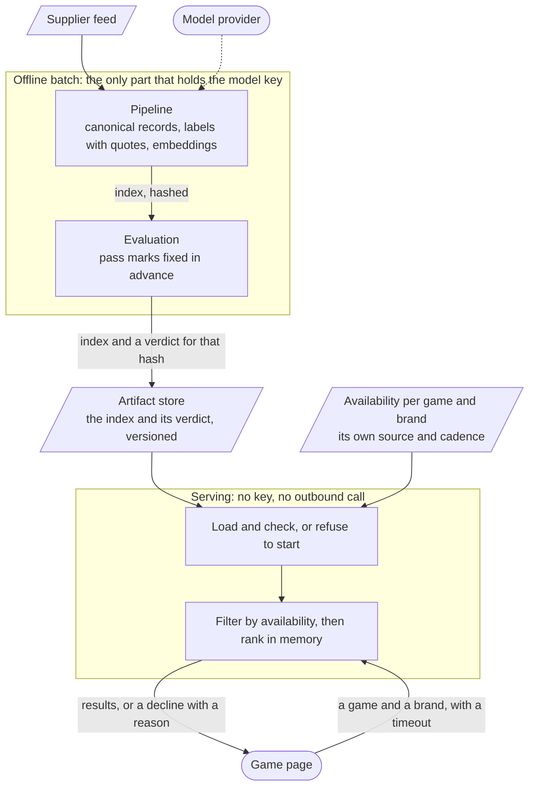

# ADR 0001: Do the AI work offline, serve from a checked index in memory

- **Status:** accepted for the prototype. The production layout below is a proposal: none of it is deployed.
- **Date:** 2026-11-19
- **Author:** Andrii Pasternak

This file holds the reasons. How the parts fit together as built is in [`docs/architecture.md`](../architecture.md), and each part's promises with their proofs are in [`docs/features/`](../features/). Neither is restated here.

## Context

A "because you played X, you might like…" rail on a casino site. Five facts shape every choice:

1. **Players see the output**, on a real-money product, in more than one jurisdiction. A game that is not live on a brand must never be recommended there.
2. **The page has a latency budget.** The rail is an extra on that page, not the reason for it.
3. **Supplier records are uneven.** Many are thin, inconsistent or partly wrong, which is why a model is asked to enrich them.
4. **A model's output varies** between runs, models and prompts. Something has to decide whether a new batch of it is good enough to put in front of players.
5. **The catalogue is small and changes slowly.** About 100 games here; a real lobby is far larger. Availability changes faster than game text.

## Decision

**Every model call happens offline. The service answers from files that an evaluation has passed, held in memory, and declines when it has nothing good enough.**

The diagram shows the proposal. In this repository the artifact store is the repository itself, availability is one file, and the game page is the console or a `curl`.

| Part of the decision | Built in this repository | Proposed for production, not built |
|---|---|---|
| Model calls are offline only | The pipeline calls the models and stores every response. The evaluation and the service replay them with no key | A scheduled batch job. Only its role can read the model key |
| The index is a hashed artifact | Files in the repository, with one hash that changes when anything in them does | A versioned object in an artifact store. Rolling back is pointing at the previous version |
| Serving is gated | The service refuses to start without a passing verdict for exactly the index it loads. It applies the pass marks to the report again at the start, so a verdict edited by hand is refused | A new version receives traffic only after its instances have started, so a failed gate leaves the old version serving |
| Ranking is an exact scan in memory | A pass over every vector of the served version, after the availability filter | Stateless containers behind a load balancer, in more than one zone. Each holds the whole index |
| Availability is separate from the index | Its own file, read at the start. A change needs a restart and no new evaluation | Its own feed, refreshed without a deploy. See "How it scales" |
| A weak answer is a decline | One of four reason codes and no results | The page hides the rail. It never shows a weaker list |

AWS is assumed for the proposal, and nothing depends on it: the pieces are a batch job, an object store, a secrets store and a container service, which every large provider has.

## Alternatives considered

| Alternative | Why it is credible | Why it was not chosen |
|---|---|---|
| Call the model, or embed, while serving a request | Always uses the latest text; no batch to run | It puts a provider's latency, cost, outages and run-to-run variation on a player's page, and nothing a request needs changes that fast. It also leaves no point at which an output can be checked before a player sees it |
| A vector database | The standard answer for similarity search | At this size an exact scan in memory is simpler and exact, and "filter before ranking" is a few lines in one plain function that a test can check for every game on every brand. A database adds a thing to run and a second place where the filter could be wrong |
| Precomputed lists of neighbours per game and brand | The request becomes a lookup | Every availability change means recomputing lists, and a list cut to its top few before filtering can leave a small brand with nothing. It becomes the right answer when the scan stops being cheap |
| Let the model write a free-text profile of each game, and embed that | Less code than a fixed list of labels with quotes | Code cannot check prose. A fixed list with a quote behind every label can be scored against an answer key, and a label with no quote can be refused |
| Local, open-weight models | No paid calls; nothing leaves the machine | A reviewer needs no model at all, because the responses are stored. A local model would add a download and machine-to-machine variation for weaker enrichment |
| Recommend from what players play next | It measures the thing the rail is for | There is no play data for a fictional catalogue, and a new game has none on day one. It is the natural second signal, not the first |
| No model: a synonym table only | No model cost or risk at all | It was built and evaluated as one of four versions, not argued away. See the next section |

## How the model's place was decided

The pipeline builds four versions of every game's text: as delivered, with labels from a plain synonym table, with the model called only on records the table leaves thin, and with the model called on every record. One evaluation scores all four against pass marks the owner committed before any result existed, and ships the cheapest version within a small margin of the best.

So "is the model worth it" is answered by a run, and the answer can change. The current one is in [`eval/results/verdict.json`](../../eval/results/verdict.json), every run so far is in [`eval/results/runs.json`](../../eval/results/runs.json), and the numbers are set out in [`docs/features/service.md`](../features/service.md).

## Trade-offs accepted

| Accepted | In exchange for | What it costs |
|---|---|---|
| A change reaches players only at the next start | A request path with no key, no network and nothing that can change under it | A withdrawn game can still be recommended until the restart. That is tolerable for a prototype and not for a regulated site, so it is the first item under "How it scales" |
| Declining instead of falling back | Never showing a result the system has no reason to believe in | Fewer rails shown. The similarity floor turns away some requests that had a good answer; one is in the evaluation's failure gallery |
| A fixed list of 24 labels | Labels that can be counted, compared and traced to a quote | Coarse descriptions. A game's character beyond the list reaches the index only through its delivered text |
| Facts such as RTP, volatility and stake limits are carried as delivered and never parsed | No wrong number in a regulated field, and no parser for formats that differ by studio | The rail cannot filter or rank on them. Where a description mentions them, they still reach the embedding text |
| The answer key comes from the generator, not from people | An evaluation over the whole catalogue with none of the owner's time spent labelling | Circularity. One vendor's models wrote the catalogue, did the enrichment and act as the reviewer of disputed cases |
| The model responses are committed | Anyone can rebuild and evaluate with no key, byte for byte | A larger repository, and a replay shows what the model said then, not what it would say today |

## Failure behaviour

The rule is the same everywhere: **when in doubt, show nothing.** A missing rail costs a little; a wrong recommendation on a regulated product costs more.

| What is unavailable | What the system does | What the player sees |
|---|---|---|
| The model provider is down, slow or refuses | Only the offline rebuild is affected. A refusal, a cut-short answer or an API error is rejected and counted, never repaired | No change. The last passing index keeps serving |
| A new index fails the evaluation | The verdict does not pass, and the service will not start on that index | No change, with recommendations that are older than intended |
| The index, the verdict or the availability file is missing, damaged or mismatched | The service refuses to start and says why | No change if an older version is still running. Otherwise no rail |
| The game is unknown, is not live on the brand, or has too little data | A decline with a reason code and no results | No rail |
| Nothing that is live on the brand is similar enough | A decline: `nothing_above_floor` | No rail |
| The service fails or is slow on one request | An error with no results. The page's own timeout covers slowness | No rail. The rest of the page is unaffected |
| A game is withdrawn on a brand | It is removed before any ranking, from the next start | Nothing, after the restart. Until then it can still appear: the gap named above |

The last column depends on one thing this repository does not contain: **the page that calls the service must hide the rail on a decline, an error or a timeout.** That is a contract with the host page, stated here as an assumption.

## How it scales, and what would trigger the work

| Trigger | Work | Why not now |
|---|---|---|
| A withdrawal has to take effect within minutes, which a regulated launch will require | Refresh availability without a restart: load a new snapshot beside the old one, check it, swap. Report its age in every response | The verdict is already independent of availability, so this needs no new evaluation. It was left out to keep the prototype's request path fixed |
| More traffic than one instance serves within the page budget | More instances. They share nothing and write nothing | Nothing to do until a load test or production latency says so. No load test was run |
| The scan takes a visible share of the latency budget. Expected somewhere in the tens of thousands of games; not measured | An approximate index, or neighbours precomputed offline. Either way the availability filter still runs at request time | At 100 games the scan is not worth measuring. The trace already reports the time of each stage |
| The catalogue changes daily, or rebuilding costs real money | Enrich and embed only records whose content changed | Embeddings are already made only for texts that changed. For enrichment a changed record is detected and stops the rebuild; asking the model again for it is a manual step |
| A second supplier feed, or game types beyond slots | A synonym table per feed, and a definition of "related" per game type | One feed shape and slots only were assumed |
| Several jurisdictions on one brand | Availability keyed by game, brand and jurisdiction | One jurisdiction per brand was assumed |

## What evidence would cause a rethink

| Evidence | What it would put in question |
|---|---|
| Against a holdout, the rail does not raise game launches, or a safer-gambling guardrail agreed in advance is breached | Content similarity as the basis for the rail at all |
| On real supplier data, the model's labels fall below the precision mark, or tags the table does not know become common | Whether enrichment is safe to automate, and whether the table can stay a hand-written list |
| On real data the table version lands within the margin of the model versions | The model's place. The ship rule would already pick the table |
| The owner's answers, or a monthly sample judged by people, disagree with the reviewer model | The answer key and the reviewer. Human reference labels would be needed |
| Real conflicts between a tag and a description where the tag is the correct side | The rule that the text is trusted over the tag. In this catalogue the description is right in all five planted cases, so that cost has not been measured |
| Decline rates on small brands that product finds too high | Declining without a fallback list |
| A second way of enriching passes the same gate at lower cost | Generative enrichment with quotes. One such method, a classifier-style call that returns a probability per label, was designed and left as a follow-up |
| The embedding model is retired or changes | Nothing in the design. The index is rebuilt and must pass the evaluation again before it is served |

## Not decided here

- **Who may see the rail.** The service assumes the host decides that for each player, and calls it only when recommendations are allowed. Self-exclusion, age and any graded response to risk are not in the catalogue and are not this service's to judge.
- **What "better" means once it is live.** The metrics to watch are listed in the [README](../../README.md#metrics-to-watch-in-production). On a real-money product more clicks is not automatically better, so the guardrails belong to the people who own safer-gambling policy.
