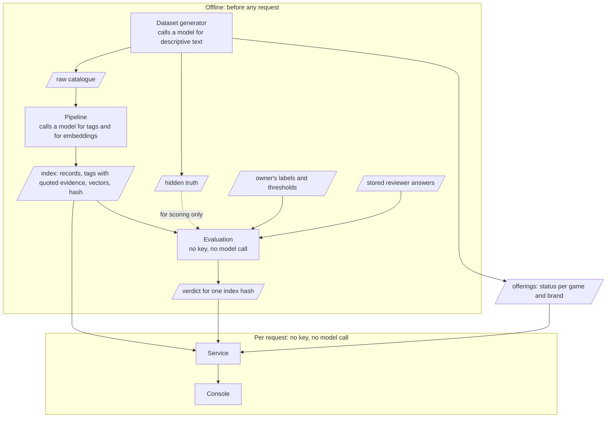

# Architecture

How the parts of the system fit together: what each part reads and writes, what runs offline and what runs for a request, and where each product rule is enforced. It is a living description, kept true as the system changes.

**Status.** This file describes the design. It does not record what exists, and it was written before any part had merged. Two facts have one home each, in the part files under [`docs/features/`](features/): whether a part exists is that file's **Status** line, and whether an invariant holds is its **Last proved** cell. Every table below links each row to that home, so read the status there. Issue numbers refer to this repository's issues.

**What lives elsewhere.**

- A part's status, where its code and files are, its invariants and the command that proves each: its part file. This file cites invariants by ID and does not restate them.
- Why the system has this shape, the alternatives and the trade-offs: the decision record that #5 asks for.
- The rules for working here: [`AGENTS.md`](../AGENTS.md).

**One word.** "Pipeline" in this file means the part described in [`pipeline.md`](features/pipeline.md): enrichment, embedding and the index. `AGENTS.md` also uses the word for all of the offline work, the dataset generator included.

## The system in one diagram

Rectangles are code and slanted boxes are files. The diagram shows the design, not what exists.

## What runs when

| Mode | Key | Model call | What happens | Defined in |
|---|---|---|---|---|
| Regenerate | needed | yes | A model is called and every response is stored | [`dataset.md`](features/dataset.md), [`pipeline.md`](features/pipeline.md) |
| Rebuild | none | no | The stored responses are replayed | [DS-1](features/dataset.md), #2 |
| Ask the reviewer | needed | yes | A second model answers the questions the answer key cannot decide. Every answer is stored, and a spend limit stops the run | [EV-5, EV-7](features/service.md) |
| Evaluate | none | no | The stored outputs and the stored reviewer answers are scored against the owner's references, and a verdict is written for one index | [EV-1, EV-2](features/service.md), #6 |
| Start the service | none | no | The index, the offerings and the verdict are loaded and checked before anything is served | [PL-4](features/pipeline.md), [SV-5](features/service.md) |
| Answer a request | none | no | In-memory work over what was loaded at the start, described below | [SV-2](features/service.md) |

**One request.** The service takes one game and one brand. #3 holds the detail. The shape is four steps:

1. **Look up** the game and the brand. #3 lists the reasons for declining here.
2. **Filter by availability** ([SV-1](features/service.md)).
3. **Score and rank** what is left against the anchor game. With about 100 games (#1) and no vector database (#2), this is a pass over the whole index in memory.
4. **Answer** with results or a decline ([SV-4](features/service.md)), and with a trace when the request asks for one (#3).

Product rule 3 fixes one thing: step 2 comes before step 3. #3 settled where the other removals sit, and the order has one home: "One request" in [`service.md`](features/service.md). Those are the anchor's duplicates and its family ([SV-3](features/service.md)), a record with too little data, and the similarity floor.

Offerings are read when the service starts, so a change to them takes effect at the next start (#3). Such a change does not call for a new evaluation: the verdict is bound to the index and the pass marks, not to the offerings ([SV-6](features/service.md)).

## Files between the parts

Everything a later stage needs is a file committed to the repository (#2). That is what lets the evaluation and the service run with no key. The name of each file belongs to the part that writes it, so it is in that part's file and not here.

| What | Written by | Read by | Name and status |
|---|---|---|---|
| Raw catalogue | Dataset generator | Pipeline | [`dataset.md`](features/dataset.md) |
| Offerings: a status per game and brand | Dataset generator, standing in for the source system | Service | [`dataset.md`](features/dataset.md) |
| Hidden truth | Dataset generator | Evaluation. Never the pipeline (#2) | [`dataset.md`](features/dataset.md) |
| Stored model responses | The part that made the call | The same part, on rebuild or re-run | [`dataset.md`](features/dataset.md), [`pipeline.md`](features/pipeline.md), [`service.md`](features/service.md) for the reviewer's answers |
| Index: records, tags with their quoted evidence, vectors, hash | Pipeline | Evaluation, service | [`pipeline.md`](features/pipeline.md) |
| The owner's references and thresholds | The owner only ([What is the owner's](../AGENTS.md#what-is-the-owners)) | Evaluation | [`service.md`](features/service.md), #6 |
| Verdict | Evaluation | Service | [`service.md`](features/service.md) |

## Where each product rule is enforced

The three [product rules](../AGENTS.md#product-rules) are meant to hold by structure, not by care. A rule is enforced only as far as the invariants beside it are proven, so read their **Last proved** cells. Where a cell holds `-`, the rule is held by `AGENTS.md` and by review alone.

| Rule | Where in the structure | Invariants |
|---|---|---|
| 1. The LLM never writes facts or availability | At the two places a model is called, the dataset generator and the pipeline. The boundary is the shape of what a model's answer is allowed to hold. Availability has a file of its own, apart from the records a model's answer is merged into | [DS-2](features/dataset.md), [PL-1](features/pipeline.md) |
| 2. No AI call in the request path | At the line between the two boxes of the diagram. What crosses it is files. Nothing on the request side holds a key | [SV-2, EV-1](features/service.md), [UI-1](features/interface.md) |
| 3. Availability is filtered before ranking | In the service's core function, between step 2 and step 3 above | [SV-1](features/service.md) |

Three more boundaries shape the design.

- **Serving is gated by the evaluation** ([SV-5](features/service.md)). The service checks the verdict against the evaluation's report and applies the gate to that report's numbers again, so a verdict cannot be written by hand.
- **The hidden truth stays hidden from the pipeline.** #2 asks for a check of that.
- **Catalogue text is data** ([Safety](../AGENTS.md#safety)). On the page it is escaped ([UI-5](features/interface.md)).

## Parts

| Part | Role | Status, code and invariants | Issue |
|---|---|---|---|
| Dataset | Generates the messy catalogue, the offerings and the hidden truth | [`dataset.md`](features/dataset.md) | #1 |
| Pipeline | Turns raw rows into the index | [`pipeline.md`](features/pipeline.md) | #2 |
| Service | Answers one game on one brand | [`service.md`](features/service.md) | #3 |
| Evaluation | Decides whether an index may be served | [`service.md`](features/service.md) | #3, #6 |
| Console | Shows what the service did for one request, and the evaluation behind what is served | [`interface.md`](features/interface.md). How it should read: [`ui-guidelines.md`](ui-guidelines.md) | #3, #4 |

#3 asks for the recommender core to be a plain function with a thin HTTP wrapper. That lets the rules above be tested without a server.

## Technology

- **Language and commands.** See [Commands](../AGENTS.md#commands).
- **Storage.** Files in the repository. There is no vector database (#2).
- **Models.** Called by the offline scripts only, with the key read from the environment (`.env.example` lists the variable). #2 asks for the index to record the model identifiers and the prompt version.

## Keeping this true

A pull request that changes what this file describes updates it (#7): a part, a file that crosses a boundary, when something runs, or where a rule is enforced. A part's status does not go here. Invariants go to the part's file, and reasons go to the pull request or to the decision record (#5).
