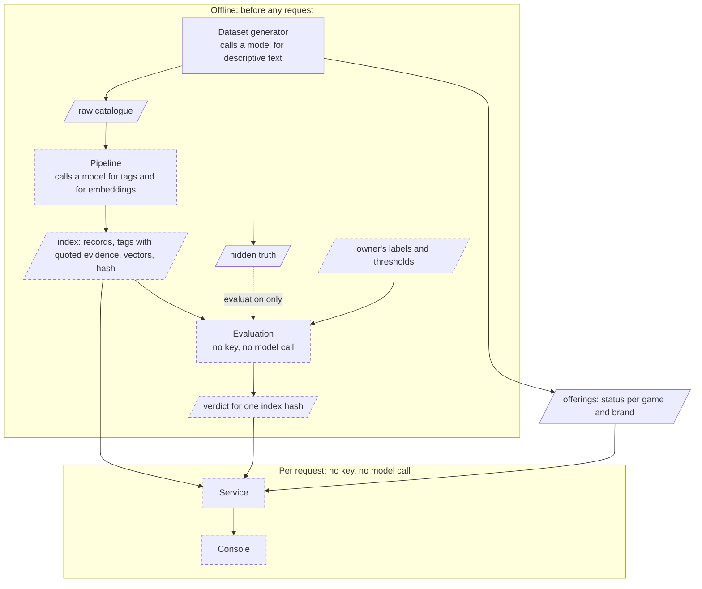

# Architecture

How the parts of the system fit together: what each part reads and writes, what runs offline and what runs for a request, and where each product rule is enforced. It is a living description, kept true as the system is built.

**Status: nothing described here is on `main` yet.** `main` holds the working rules and these documents. The dataset is in progress (#1) and every other part is planned. Each table carries a status column: "in progress" means code exists on a feature branch that has not merged, and "planned" means there is no code to run. Issue numbers refer to this repository's issues.

**What lives elsewhere.**

- A part's invariants, and the command that proves each, are in [`docs/features/`](features/). This file points to them by ID and does not restate them.
- Why the system has this shape, the alternatives and the trade-offs belong to the decision record, which is planned (#5).
- The rules for working here are in [`AGENTS.md`](../AGENTS.md).

## The system in one diagram

Rectangles are code and slanted boxes are files. A dashed outline means planned. The solid boxes are in progress (#1) and not on `main`.

## What runs when

| Mode | Key | Model call | What happens | Status |
|---|---|---|---|---|
| Regenerate | needed | yes | The generator or the pipeline calls the model and stores every response it receives | generator in progress (#1); pipeline planned (#2) |
| Rebuild | none | no | The same code replays the stored responses and has to reproduce its output byte for byte | generator in progress (#1); pipeline planned (#2) |
| Evaluate | none | no | The committed outputs are scored against the owner's references, and a verdict is written for the hash of the index that was scored | planned (#3, owner inputs #6) |
| Start the service | none | no | The index, the offerings and the verdict are loaded and checked. An invalid index stops the start. An index with no passing verdict is not served | planned (#3) |
| Answer a request | none | no | In-memory work over what was loaded at the start, described below | planned (#3) |

**One request (planned, #3).** The input is one game and one brand.

1. Decline if the game is unknown or is not live on the brand.
2. Remove every game that is not live on the brand.
3. Remove the anchor game itself and its duplicates. Decline if there is too little data.
4. Score what is left by similarity to the anchor and rank it. With about 100 games this is a pass over the whole index in memory.
5. Keep at most one result from the anchor's own family and drop anything under the similarity floor.
6. Return the results, or a decline with its reason. On request the response also carries a trace of steps 1 to 5.

The fixed point is that step 2 comes before step 4. The order of the other steps is the service pull request's to settle. Offerings are read at the start, so a change to them takes effect at the next start and needs no new evaluation.

## Files between the parts

Everything a later stage needs is a plain file committed to the repository. That is what lets the evaluation and the service run with no key.

| File or folder | Written by | Read by | Status |
|---|---|---|---|
| `data/catalogue.raw.jsonl` | Generator | Pipeline | in progress (#1), not on `main` |
| `data/offerings.jsonl` | Generator, standing in for the source system | Service | in progress (#1), not on `main` |
| `data/generation/`: hidden truth, stored model responses, cost ledger, mess report | Generator | Generator, and evaluation for the truth. Never the pipeline or the service | in progress (#1), not on `main` |
| Stored model responses, enriched records and the index, under `data/` | Pipeline | Pipeline on rebuild, evaluation, service | planned (#2), names not decided |
| `prompts/` | Whoever changes a prompt | Pipeline | planned (#2) |
| `eval/refs/`, `eval/thresholds.json` | The owner only | Evaluation | planned (#6) |
| Verdict | Evaluation | Service | planned (#3), name not decided |

The paths marked in progress are the ones the dataset work uses today. [`docs/features/dataset.md`](features/dataset.md) becomes their home when #1 merges.

## Where each product rule is enforced

The three [product rules](../AGENTS.md#product-rules) are meant to hold by structure, not by care. Until the code in the status column merges, each is held only by `AGENTS.md` and by review: nothing in the repository enforces any of them today.

| Rule | Where the structure holds it | Invariants | Status |
|---|---|---|---|
| 1. The LLM never writes facts or availability | In the generator, the plan and the degradation are seeded code, and the model supplies wording only. In the pipeline, the enrichment result has a shape with room for theme and mechanic tags and nothing else. Offerings are a separate file that the pipeline does not write | [DS-2](features/dataset.md), [PL-1](features/pipeline.md) | generator in progress (#1); pipeline planned (#2) |
| 2. No AI call in the request path | Model calls exist only in the generator and the pipeline, and their responses are stored. The service, the evaluation and the console work from files | [SV-2, EV-1](features/service.md), [UI-1](features/interface.md) | planned (#3) |
| 3. Availability is filtered before ranking | In the service's core function, which removes games that are not live before it computes a score (step 2 above) | [SV-1](features/service.md) | planned (#3) |

Three more boundaries shape the design. All are planned.

- **Serving is gated by the evaluation.** The verdict names the hash of the index it judged, and the service checks the pair ([SV-5](features/service.md), #3).
- **The hidden truth stays hidden.** The pipeline and the service never read `data/generation/`, which is planned (#1, #2) and has no check yet.
- **Catalogue text is data.** One record carries instruction-like text on purpose. See [Safety](../AGENTS.md#safety).

## Parts

| Part | Role | Invariants | Paths its issue reserves | Status | Issue |
|---|---|---|---|---|---|
| Dataset | Generates the messy catalogue, the offerings and the hidden truth | [`dataset.md`](features/dataset.md) | `src/dataset/`, `data/` | in progress, not on `main` | #1 |
| Pipeline | Turns raw rows into the index | [`pipeline.md`](features/pipeline.md) | `src/pipeline/`, `prompts/` | planned | #2 |
| Service | Answers one game on one brand | [`service.md`](features/service.md) | `src/service/` | planned | #3 |
| Evaluation | Decides whether an index may be served | [`service.md`](features/service.md) | `eval/` | planned | #3, #6 |
| Console | Shows what the service did for one request | [`interface.md`](features/interface.md), [`ui-guidelines.md`](ui-guidelines.md) | `src/console/` | planned | #3, #4 |

The recommender core is planned as a plain function with a thin HTTP wrapper (#3), so the rules above can be tested without a server.

## Technology

- **Language and commands.** See [Commands](../AGENTS.md#commands).
- **Storage.** Plain files in the repository. There is no database and no vector database.
- **Models.** One provider, called by the offline scripts only, with the key read from the environment (`.env.example` lists the variable). The model identifiers and the prompt version are planned to be recorded in the index (#2).

## Keeping this true

A pull request that changes what this file describes (a part, a file that crosses a boundary, when something runs, or where a rule is enforced) updates this file and its status columns. Invariants go to the part's file in `docs/features/`, and reasons go to the pull request or the decision record (#5).
