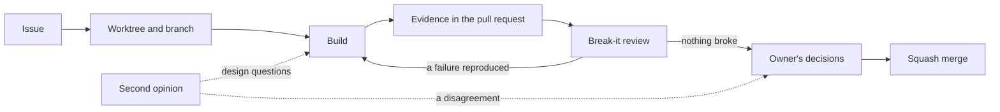

# Development workflow

The path one change takes from an issue to a squash commit on `main`, in order. This file explains how the steps connect. The rules themselves live in [`AGENTS.md`](../AGENTS.md) (working rules), [`REVIEW.md`](../REVIEW.md) (review) and [the pull request template](../.github/pull_request_template.md) (evidence). Each step links to its rule and does not repeat it. Where this file and a rule file disagree, the rule file is right.

**Status.** The rules are in force. The path has not been walked end to end: when this file was written no pull request had been merged, and the pull request that adds this file was the first opened under these rules. No step is automated or checked by a machine. See [What is not in place](#what-is-not-in-place).



## 1. Issue

A unit of work starts as an issue. The issues for agent work (#1 to #5, and #7) share one shape: the outcome as before and after, acceptance criteria, non-goals, the paths the work owns, how it will be verified, and its risk. An issue also says what blocks it. #6 is different: it is the owner's own checklist.

The acceptance criteria matter most. The evidence in step 4 and the review in step 5 are both matched against them, so a change without criteria cannot be shown to be done.

## 2. Worktree and branch

Each agent session gets its own worktree and its own branch, and the main checkout stays on `main` ([Git](../AGENTS.md#git)). From the main checkout:

```sh
git worktree add wt/<name> -b <branch> main
```

The agent that will do the work is briefed with the issue and with what it cannot see for itself ([Briefing another agent](../AGENTS.md#briefing-another-agent)).

## 3. Build

The agent works inside the paths its issue owns and commits on its branch. Apart from the owner's items, work on a feature branch needs no permission ([What is the owner's](../AGENTS.md#what-is-the-owners)).

The documents move with the code, in the same pull request. A change to a part updates that part's file in [`docs/features/`](features/). A change to what [`architecture.md`](architecture.md) or [`ui-guidelines.md`](ui-guidelines.md) describes updates that file (#7).

What counts as a test, and how failures have to behave, is in [Done](../AGENTS.md#done). The two commands are in [Commands](../AGENTS.md#commands). They are not on `main` yet.

**Second opinion.** A decision or a design question that comes up here can go to a model from a different family. It is for decisions, not for diffs ([`REVIEW.md`](../REVIEW.md)).

## 4. Evidence

The order matters, because evidence is tied to a commit:

1. Commit the change.
2. Run the proof commands on that commit and keep their output.
3. Run `tools/secret-scan.sh` and keep its output ([Safety](../AGENTS.md#safety)).
4. Push the branch and open the pull request, filling in [the template](../.github/pull_request_template.md).

The template asks for what changed, each deviation from the plan, one row per acceptance criterion matched to a command, the commit, the output, and what was not verified. The review section is left as "pending".

When a proof command for an invariant passed, its "Last proved" cell is filled in by a following commit ([Where state lives](../AGENTS.md#where-state-lives)).

## 5. Break-it review

A second agent, started with none of the builder's context, runs the change and tries to make it fail ([`REVIEW.md`](../REVIEW.md)). It comes back with a command that fails, or with the list of what it tried.

A reproduced failure sends the change back to step 3, and the failing command becomes a test. Each fix is a new commit, so step 4 runs again on it. Every finding is written into the pull request's review table, including the ones that did not reproduce.

## 6. Owner's decisions

Some things an agent hands over and does not decide. The list is in [What is the owner's](../AGENTS.md#what-is-the-owners). Two more arrive from review: a disagreement between models that running something did not settle, and a finding the owner chooses to accept.

For the console, the owner looks at it. Agents show that it works and do not say how it looks ([`ui-guidelines.md`](ui-guidelines.md#what-only-the-owner-judges)).

## 7. Squash merge

The owner merges, and squash is the only merge. The pull request title becomes the one commit on `main` ([Git](../AGENTS.md#git)). After the merge, `git log` on `main` is the record of what changed and the pull request is the record of why ([Where state lives](../AGENTS.md#where-state-lives)).

A mistake worth not repeating adds a line to [`LEARNINGS.md`](../LEARNINGS.md), in the pull request that fixes its cause.

## What is not in place

- **No continuous integration.** Nothing runs on a push or on a pull request, and no open issue plans it.
- **Nothing checks the template.** A pull request with an empty evidence table can be opened. The review and the owner are the check.
- **The secret scan is run by hand.** See [Safety](../AGENTS.md#safety).
- **The owner's files are protected only in part.** [What is the owner's](../AGENTS.md#what-is-the-owners) says what the project settings stop and what they do not.
- **`npm run typecheck` and `npm test` are not on `main`.** They are planned to arrive with the first product pull request (#1).
