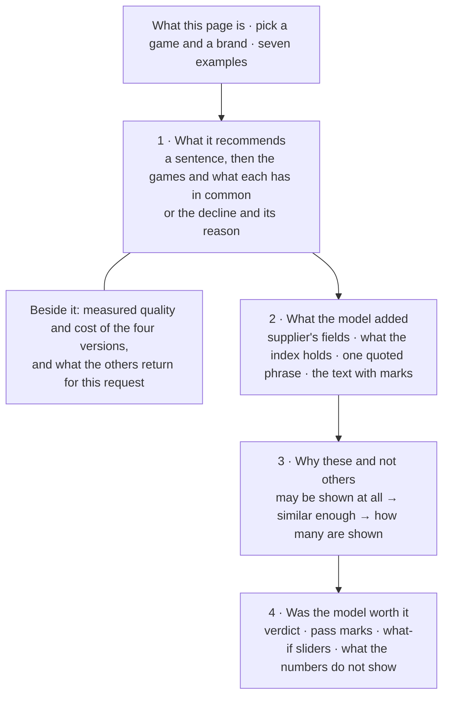

# Interface

**Status:** built, in the near-black and green look the owner chose for #4, and rebuilt at his request so that the result comes first. How it looks is not signed off: that is the owner's, and #4 stays open until he has looked.

**Purpose.** A console, served by the service at `/`, that opens the recommender up: what it recommends for one game on one brand, the evidence for it, and whether the language model earned its cost. It is the inspection view, not the screen a player would see, and it says so in its first line. A reader who has never seen the project should be able to follow it without help.

The page answers four questions in this order. The first is on the first screen; the rest are beneath it, and everything that is true and not first is folded under a control that names it. The order is a rule: [`ui-guidelines.md`](../ui-guidelines.md#the-order-of-the-page).

| Part | What it shows without opening anything | Folded under a named control |
|---|---|---|
| Header | What the page is, the pickers, and the examples | |
| 1 · What it recommends | "Given *game* on *brand*, the service returns *n* related games that are live there", then each game with the labels it has in common with the game played. A decline takes the same place, with its reason in a sentence. A failure the evaluation lists for this game is said under the result | |
| Beside it | Pairwise accuracy and build cost of the four versions, with the served one and any failed pass mark labelled; then, for this request, how many of these games each other version returns | |
| 2 · What the model added | One or two sentences on what happened; the supplier's structured fields; the labels the version holds; one phrase the model read; the title and description with every quoted phrase marked and numbered | The steps one by one with model and prompt names; the raw record |
| 3 · Why these and not others | The trace's filters as three stages with the count left after each: which games may be shown at all (availability first), which are similar enough (the floor, and what the floor is), how many are shown (and which games cleared the floor and are not shown). A step opens the list of what it removed | Every score against the floor; index, floor rule and timings |
| The same request in every version | | A matrix of which games each version returns and at what rank, then the labels each holds with their quotes |
| 4 · Was the model worth it | The served version, one sentence of measured facts, the gate's own words, the state of the owner's check; every pass mark as pass or fail per version; the what-if button; what the numbers do not show | The numbers behind the chart; accuracy by the condition of the record; the enrichment measures, the contradicted tags, the disagreements and the reviewer; the failures the evaluation found |

- **What a result has in common with the game played** is the labels both records hold in the version shown. It is worded as what they share. The page says the order is a similarity between two texts and cannot be traced to single labels.
- **A different list is not called a better list.** Which version ranks better rests on the evaluation's numbers, shown beside the result, with what they do not show.
- **The version picker** defaults to the served version. Any other is marked "inspection" on its result: the same core over another version of the index, never what a player is served.
- **The what-if panel changes no file.** A move sends one `GET /api/what-if` with the marks in the URL; the service applies the real gate to the measured numbers and writes nothing. The panel says that the release gate reads only `eval/thresholds.json`.
- **A request can be linked:** `/?game=<id>&brand=<brand>&version=<version>`. `&show=versions` opens the comparison of versions, and `&focus=<id>` opens the step that removed that game and marks it. A link to a game the index does not hold shows the service's `unknown_game` decline. The page never scrolls itself.
- **While the owner's check is outstanding** the evaluation says how many of the reviewer's answers are held back and why, and shows none of them: it renders the report, and the report holds none.
- **Nothing on the page is fixed in the code.** Every game, count, score, bar and tick is drawn from a response, so a rebuilt index or a re-run evaluation changes the page and no file of the console.

## The examples

Start it with `npm run serve` and open `http://127.0.0.1:8787`. If the port is taken: `npm run serve -- --port 9000`.

The page opens on the first example and offers all seven as links. Each is found by asking the service, so they follow the catalogue: a rebuild may change the game, and an example the data no longer holds is shown as not found. With the index and evaluation committed now they are:

| Example | What it shows | Link | First screen | Evidence |
|---|---|---|---|---|
| A thin record gains labels | The supplier's tags gave no label; the model added six from the text | `/?game=ulv-26904&brand=tavrenmoor&show=added` | [desktop](../screenshots/desktop-first-screen-thin.png), [phone](../screenshots/phone-first-screen-thin.png) | [desktop](../screenshots/desktop-evidence-thin.png), [phone](../screenshots/phone-evidence-thin.png) |
| Already well described: the model adds nothing | The supplier's tags already gave every label the index holds | `/?game=drw-12933&brand=tavrenmoor&show=added` | [desktop](../screenshots/desktop-first-screen-plain.png), [phone](../screenshots/phone-first-screen-plain.png) | |
| A tag contradicts the description | The table asserts no mechanic; the model reads the text | `/?game=okk-17457&brand=tavrenmoor&show=added` | [desktop](../screenshots/desktop-first-screen-conflict.png), [phone](../screenshots/phone-first-screen-conflict.png) | [desktop](../screenshots/desktop-evidence-conflict.png), [phone](../screenshots/phone-evidence-conflict.png) |
| A plausible game is removed | The best match on one brand is withdrawn on the other, and is removed before anything is scored | `/?game=drw-21965&brand=tavrenmoor&focus=thr-27417` | [desktop](../screenshots/desktop-first-screen-filter.png), [phone](../screenshots/phone-first-screen-filter.png) | [desktop](../screenshots/desktop-evidence-filter.png), [phone](../screenshots/phone-evidence-filter.png) |
| A decline instead of a guess | A record with nothing to compare on is declined, with the reason | `/?game=okk-78064&brand=tavrenmoor` | [desktop](../screenshots/desktop-first-screen-decline.png), [phone](../screenshots/phone-first-screen-decline.png) | |
| The versions disagree | The four versions return different games for the same request | `/?game=okk-85222&brand=tavrenmoor&show=versions` | [desktop](../screenshots/desktop-first-screen-versions.png), [phone](../screenshots/phone-first-screen-versions.png) | [desktop](../screenshots/desktop-evidence-versions.png), [phone](../screenshots/phone-evidence-versions.png) |
| A failure the evaluation found | A label the plan says can be recovered from the text, which the served version did not assert | `/?game=thr-86641&brand=tavrenmoor` | [desktop](../screenshots/desktop-first-screen-failure.png), [phone](../screenshots/phone-first-screen-failure.png) | |

Also in [`docs/screenshots/`](../screenshots/): the landing page (`first-screen-landing`), the evidence for the served version (`evidence-evaluation`) and the what-if panel with one mark moved (`evidence-what-if`), each at desktop and phone size.

A **first screen** picture is the window exactly as a visitor lands on it, 1280 by 900 or 390 by 844: not resized, not scrolled, not cropped. An **evidence** picture is one part of the page further down, with the window made as tall as the part. All are written by `node tools/console-check.ts --screenshots docs/screenshots` and show the index and evaluation committed at the time; after a rebuild, run it again.

## Code

No build step and no framework.

| Path | What it holds |
|---|---|
| `src/console/view.js` | Every view, as a plain function from the service's responses to HTML text, and the search for the examples. It touches no DOM, so the tests run it as it is |
| `src/console/view.d.ts` | Its types, for the tests |
| `src/console/app.js` | The glue: reads the controls, calls `GET /api/…`, puts a view's HTML on the page, opens a step |
| `src/console/index.html`, `console.css` | The page, and the tokens, type, components and motion of [`ui-guidelines.md`](../ui-guidelines.md) |
| `src/console/console.test.ts` | The tests. Each name starts with the invariant it proves |
| `tools/console-check.ts` | The page in a real browser: the first screens, the checks the tests cannot reach, and the screenshots. Needs a local Chrome and no package |
| `docs/screenshots/` | The pictures it wrote |

## Invariants

| ID | Invariant | Proof command | Last proved |
|---|---|---|---|
| UI-1 | Everything the console shows for a request comes from the service's response to that request. The console asks only this service's own routes and makes no model call | `npm test -- "UI-1:"` | - |
| UI-2 | A declined request shows the reason for the decline and no results, and does not look like a failure. A link that names an unknown game reaches that decline | `npm test -- "UI-2:"` | - |
| UI-3 | The page is served, and for every brand and game in its pickers the trace renders without an error, in every version | `npm test -- "UI-3:"` | - |
| UI-4 | The what-if panel states that the gate reads only the committed file, shows each committed mark, flips pass and fail as a mark moves, and changes no file | `npm test -- "UI-4:"` | - |
| UI-5 | Text from the catalogue and from a model reaches the page as text, never as markup | `npm test -- "UI-5:"` | - |
| UI-6 | For a game whose tag contradicts its description, the page shows the conflict and how each version handled it | `npm test -- "UI-6:"` | - |
| UI-7 | A quote is marked where it sits in the record's own text, the one phrase shown alone is a quote of a label the model added, a quote that cannot be placed is said and not dropped, and a bar is as long as the number the response carries | `npm test -- "UI-7:"` | - |
| UI-8 | The result or the decline comes first in the page, stated in a sentence, with the evidence beneath it in a fixed order and the detail folded away, each under a control with its own name | `npm test -- "UI-8:"` | - |
| UI-9 | What a result is said to have in common with the game played is held by both records, and is never offered as the cause of the score | `npm test -- "UI-9:"` | - |
| UI-10 | Beside the result, what the other versions return is counted as the service answered, the measured quality and cost are the report's, and a different list is not called a better one | `npm test -- "UI-10:"` | - |
| UI-11 | The path shows the trace's own counts in the trace's order, availability first, as three different things; says what the floor is; names a game that cleared the floor and is not shown; and points out a game at the step that removed it | `npm test -- "UI-11:"` | - |
| UI-12 | The examples are found in the data, each shows what it says, no game is named in the console's files, and the examples change or say "none" when the data changes | `npm test -- "UI-12:"` | - |
| UI-13 | At 1280 by 900 and at 390 by 844, the landing page and every example show what the page is, the sentence stating the outcome, and the first result or the decline, without scrolling | `node tools/console-check.ts --first-screens` | - |

What each proof does:

- **UI-1** gives the views a `get` that records every URL, and changes a score, a candidate's score and the floor in a response to see the changed numbers on the page.
- **UI-2** renders every declined request on every brand, and an unknown game, and looks for the reason code, the word "declined", no result and no red label.
- **UI-3** renders 1,200 traces and 300 comparisons through the service's own router.
- **UI-5** renders a response in which every string is a script tag, and every record whose delivered description carries markup.
- **UI-7** renders every game with the model's labels, strips the marks and their numbers from the text shown and compares it with the cleaned record, then plants a quote that is nowhere in the record and changes a score and the floor.
- **UI-8** renders every game on every brand and checks where the outcome sits in the page, the sentence, the order of the evidence, and that no drawer starts open.
- **UI-9** asks the service for both records of every result on the home brand and compares the labels shown with the labels both hold.
- **UI-10** asks the service for every other version's answer to every game and recounts the overlap; the measured numbers are compared with the report's.
- **UI-11** renders every game on every brand against its trace.
- **UI-12** checks each example against the service rather than against what the finder says, removes the chosen game to see the example move, and removes every thin record to see it say "none".
- **UI-13** loads each page in headless Chrome and asks whether the three things are wholly inside the window on arrival. Run against the layout on `main` before this change, all sixteen first screens failed: the first result began 3,466 to 5,476 pixels down, the decline 2,174 and 3,146, and the landing page showed neither.

While this was built, each of UI-7 to UI-13 was broken on purpose, one fault at a time, and failed each time: the result moved below the evidence, a drawer opened by default, labels shown as shared that only one record holds, the overlap miscounted, a step's count changed, a cut game left unnamed, an example taken without checking what it shows, an example's number changed, a failure taken from outside the evaluation's list, a mark moved one character, a lost quote dropped silently, a bar scaled, and the examples stacked on a phone so that the result left the first screen.

**What the tests do not reach, and what does.** They run the views, not a browser: `app.js`, the 200 lines that wire controls to views, is outside `npm test`. `node tools/console-check.ts` drives the page in headless Chrome at both sizes, and besides UI-13 fails when:

- an example, once opened, does not show what it says;
- the page does not offer an example the data holds, or a click on one leaves its result off the first screen;
- a step of the path does not open what it removed, or two are open at once;
- anything is wider than the window, other than a table or the strip of examples scrolling in its own box;
- a control reached with Tab shows no focus ring;
- the what-if panel cannot be opened and moved with the keyboard alone, does not say what the gate reads, loses focus when redrawn, or a file under `eval/` or `data/` has changed after the move;
- the page script raises an error;
- anything still animates under `prefers-reduced-motion`.

It is run by hand, because a machine without a browser cannot run it, and its result for a change is in that change's pull request. `--also "<link>"` adds the first screen of any other request, and `--base <url>` runs it against a service that is already running. It was also broken on purpose (the focus rule removed, the reduced-motion rule ignored, a result made wider than the window) and failed each time.

How the console looks and feels is not an invariant and has no proof command. The owner judges it by looking.
