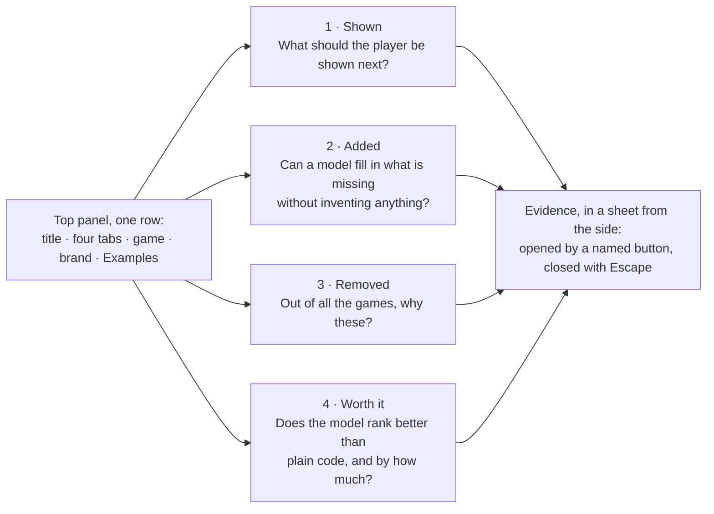

# Interface

**Status:** built as one page with four sections, switched from a panel along the top, in the near-black and green look the owner chose for #4. How it looks was signed off by the owner on 2026-11-20, after he opened it; #4 closed with #17.

**Purpose.** A page, served by the service at `/`, that opens the recommender up: what it returns for one game on one brand, the evidence for it, and whether the language model earned its cost. It is the inspection view, not the screen a player would see, and it says so at its foot. A reader who has never seen the project should be able to follow it without help.

One section is on screen at a time. Each puts a question on the left and its answer on the right: one sentence, one picture, and at most three buttons that each name the evidence they open. Everything else that is true is one press away, and never in the way. The rule is in [`ui-guidelines.md`](../ui-guidelines.md#one-section-one-question).

| Section | The sentence | The picture | Behind a button |
|---|---|---|---|
| 1 · Shown | "Given *game* on *brand*, the service returns *n* games that scored above the similarity floor and are live there, closest first." A decline takes the same place, with its reason | The games in order, each with the labels it has in common with the game played and its score. The exact score and how to read the row are a hover or a focus away | Every score against the floor; the index, version and timings |
| 2 · Added | One sentence, read from the record: how many labels the lookup table read and from which of the supplier's lists (features, themes, tags), and what the version shown holds | What the supplier sent beside what the version holds, then the supplier's text with each quoted phrase marked and numbered | The steps one by one with model and prompt names; the raw record |
| 3 · Removed | "Of the *n* games in the catalogue, *k* are shown. *m* were removed by rules before anything was scored." | One flow across the width: the count left after each step, and how many it removed. A step opens what it removed, with the reason | Every score against the floor; the index, version and timings |
| 4 · Worth it | Which version is served, its measured rate against the best version built without the model, the difference in points, and the estimated cost of each | The four versions as one comparison: rate, a bar from zero with a tick at the pass mark, estimated cost. One line under it says what the numbers cannot show | The release gate with every pass mark and the what-if sliders; this request in every version; every measured number, the failures found and the limits |

- **What the service guarantees is what the page says.** A returned game "scored above the similarity floor and is live there". The page does not call a result related: only the evaluation's answer key says what is related, and it is used only in the fourth section.
- **What a result has in common with the game played** is the labels both records hold in the version shown. It is worded as what they share, never as the cause of the score.
- **The similarity floor** is described, where it is opened, as a point in the spread of scores: a game is closer than most pairs are, not relevant to a player.
- **A different list is not called a better list.** "Better" rests only on the evaluation's numbers.
- **A cost is an estimate and reads as one:** "about $0.12", "under $0.01". The figure as the report carries it is in the evidence, labelled as an estimate.
- **A failure the evaluation found** is shown with the request it happened on: the same game, version and brand, and only while the game it names is on screen. It is said in the evaluation's own sentence, with the label it is about.
- **The version picker** lives where versions are discussed, in "This request in every version of the index". Any version other than the served one is marked on each section as shown for comparison, with a button back.
- **The what-if sliders change no file.** A move sends one `GET /api/what-if`; the service applies the real gate to the measured numbers and writes nothing.
- **A request can be linked:** `/?game=<id>&brand=<brand>&version=<version>&tab=<shown|added|removed|worth>&focus=<id>`. `focus` opens the step that removed that game and marks it. An address the page cannot read is reported for what it is: an unknown brand, version or section, a repeated or unknown parameter, a game without a brand or a brand without a game. Nothing is replaced in silence. A game the index does not hold shows the service's own decline.
- **A late answer is never drawn for another request.** Only the answer to the newest request is shown.
- **While the owner's check is outstanding** the evidence says how many of the reviewer's answers are held back and why, and shows none of them. It says they are out of the working tree and still in the repository's history, and does not point at them.
- **Nothing on the page is fixed in the code.** Every game, count, score, bar and sentence about a record is drawn from a response.

## Starting it, and the examples

`npm start` from a fresh clone (it installs what is missing, then serves), or `npm run serve` once installed; then open `http://127.0.0.1:8787`. If the port is taken: `npm start -- --port 9000`.

The page opens on the first example. **Examples**, at the right of the top panel, lists seven; each opens the section that shows it. They are found by asking the service, so they follow the catalogue: a rebuild may change the game, and an example the data no longer holds is listed as not found. The open example is marked in that list and nowhere else. With the index and evaluation committed now:

| Example | Opens | Address |
|---|---|---|
| A thin record gains labels | Added | `/?game=ulv-26904&brand=tavrenmoor&tab=added` |
| Already well described: the model adds nothing | Added | `/?game=drw-12933&brand=tavrenmoor&tab=added` |
| A tag contradicts the description | Added | `/?game=okk-17457&brand=tavrenmoor&tab=added` |
| A plausible game is removed | Removed, with the step open | `/?game=drw-21965&brand=tavrenmoor&tab=removed&focus=thr-27417` |
| A decline instead of a guess | Shown | `/?game=okk-78064&brand=tavrenmoor` |
| The versions disagree | Worth it | `/?game=okk-85222&brand=tavrenmoor&tab=worth` |
| A failure the evaluation found | Added | `/?game=thr-86641&brand=tavrenmoor&tab=added` |

## Code, and how it is built

The page is React, written without JSX so that Node runs the same files in the tests with no loader. Two open-source libraries are used where they fit:

| Library | Version, licence | Used for |
|---|---|---|
| `@ui-sdk/react`, `@ui-sdk/core` | 0.1.0-beta.13, Apache-2.0 | The tabs and their moving marker; the game picker with its search, the brand picker and the version picker; the list of examples (popover); the evidence sheet (drawer); the steps of the path and the parts of a larger piece of evidence (accordion); every bar (meter); the what-if sliders; the exact score on hover or focus (tooltip). Its stylesheet is the base layer, with its variables pointed at this page's tokens |
| `metal-fx` | 2.0.11, MIT | The liquid-metal ring on two controls: the marker of the open tab and the Examples button. Without WebGL2 it draws nothing and both stay plain and usable |
| `react`, `react-dom` | 19.3.1, MIT | Rendering |

Not used where they do not fit: tables, the list of results, the marked text and the labels are plain elements, because the libraries offer nothing that says them more plainly; and the metal effect is on no number, bar or sentence, because an effect on data would decorate a measurement.

**The build, and the promise it must not break.** The repository's promise is that after `npm install`, `npm run eval` and `npm run serve` work with no key, no network and no further step. A page that uses packages has to be bundled, so the bundle is committed: `npm run build` (esbuild) writes `src/console/dist/`, the service serves those files, and they hold everything the page needs. The page loads nothing from outside the machine. The packages and the bundler are development dependencies; the service still needs only what it needed before. `npm test -- "UI-14:"` rebuilds from source and fails when the committed files differ, or are not in the repository. After changing anything under `src/console/`, run `npm run build` and commit the result. There is no continuous integration in this repository, so drift is caught only when someone runs `npm test`. The bundler's install script is switched off in `package.json` (`allowScripts`): the build does not need it, and gives the same bytes without it.

| Path | What it holds |
|---|---|
| `src/console/read.ts` | Reading, with no markup: the address, the requests, the examples, which failures belong to a request, the sentence about a record |
| `src/console/view.ts` | The four sections, as functions from the service's responses to elements |
| `src/console/evidence.ts` | What each evidence button opens |
| `src/console/app.ts`, `main.ts` | The shell: the top panel, the address, the requests, the sheet; and the browser's entry |
| `src/console/styles.css`, `index.html` | The tokens, type, layout and motion of [`ui-guidelines.md`](../ui-guidelines.md), and the page the script fills |
| `src/console/dist/` | The built script and stylesheet the service serves, and `THIRD-PARTY-NOTICES.txt` with the licence of every package inside them |
| `tools/build-console.ts` | The build, and the comparison of a fresh build with the committed files |
| `src/console/console.test.ts` | The tests. Each name starts with the invariant it proves |
| `tools/console-check.ts` | The page in a real browser. Needs a local Chrome and no package |

## Invariants

| ID | Invariant | Proof command | Last proved |
|---|---|---|---|
| UI-1 | Everything the page shows for a request comes from the service's response to that request. The page asks only this service's own routes and makes no model call | `npm test -- "UI-1:"` | `a8620e7` |
| UI-2 | A declined request shows the reason for the decline and no results, and does not look like a failure. An address that names an unknown game reaches that decline | `npm test -- "UI-2:"` | `a8620e7` |
| UI-3 | The page is served, and for every brand, game and version every section renders, with its evidence | `npm test -- "UI-3:"` | `a8620e7` |
| UI-4 | The what-if panel states that the gate reads only the committed file, shows each committed mark, flips pass and fail as a mark moves, and changes no file | `npm test -- "UI-4:"` | `a8620e7` |
| UI-5 | Text from the catalogue and from a model reaches the page as text, never as markup | `npm test -- "UI-5:"` | `a8620e7` |
| UI-6 | For a game whose tag contradicts its description, the page shows the conflict and how each version handled it | `npm test -- "UI-6:"` | `a8620e7` |
| UI-7 | A quote is marked where it sits in the record's own text, a quote that cannot be placed is said and not dropped, and a bar is as long as the number the response carries | `npm test -- "UI-7:"` | `a8620e7` |
| UI-8 | Each section states one question with one short line, answers it in one sentence, and keeps everything else out of sight under at most three buttons, each named for what it opens | `npm test -- "UI-8:"` | `a8620e7` |
| UI-9 | What a result is said to have in common with the game played is held by both records, and is never offered as the cause of the score | `npm test -- "UI-9:"` | `a8620e7` |
| UI-10 | What the other versions return is counted as the service answered; the measured numbers are the report's; each bar is as long as its rate, from zero; a cost reads as an estimate; a different list is not called a better one | `npm test -- "UI-10:"` | `a8620e7` |
| UI-11 | The path shows the trace's own counts in the trace's order, availability first, as three different things; says what the floor is; names a game that cleared the floor and is not shown; and points out a game at the step that removed it | `npm test -- "UI-11:"` | `a8620e7` |
| UI-12 | The examples are found in the data, each shows what it says, no game is named in the page's files, and the examples change or say "none" when the data changes | `npm test -- "UI-12:"` | `a8620e7` |
| UI-13 | On arrival, with no scrolling, the top panel, the question and the sentence that answers it are on screen, for the landing page and every example, at 1280 by 900, 1366 by 657, 390 by 844 and 390 by 664. In the two desktop windows so is the first thing of the answer; on a phone the rest scrolls | `node tools/console-check.ts --first-screens` | `a8620e7` |
| UI-14 | The script and stylesheet the service serves are what the source builds, are in the repository, carry the notices of the packages inside them, and fetch from no other host | `npm test -- "UI-14:"` | `a8620e7` |
| UI-15 | A returned game is described as above the similarity floor and live on the brand, and is never called related | `npm test -- "UI-15:"` | `a8620e7` |
| UI-16 | What the page says the lookup table and the model found is read from the record, in every version | `npm test -- "UI-16:"` | `a8620e7` |
| UI-17 | A failure the evaluation found is shown where it happened, and nowhere else | `npm test -- "UI-17:"` | `a8620e7` |
| UI-18 | A late answer is never shown for another request | `npm test -- "UI-18:"` | `a8620e7` |
| UI-19 | A brand, a version, a section or a parameter the page does not know is reported for what it is, and nothing is replaced in silence | `npm test -- "UI-19:"` | `a8620e7` |
| UI-20 | The split by record condition is not offered as the model's work, the limits are the plan's, and the held-back answers are described as they are | `npm test -- "UI-20:"` | `a8620e7` |
| UI-21 | UI-13 holds for every game on every brand: in the served version at 1366 by 657 and at 390 by 664, and in every other version at 390 by 664 | `node tools/console-check.ts --every-request` | `a8620e7` |
| UI-22 | In a browser the page does what it says (the list under this table): by pointer and with the keyboard alone, with reduced motion, without WebGL2, and asking nothing outside this service | `node tools/console-check.ts` | `a8620e7` |

What each proof does:

- **UI-1** gives the sections a `get` that records every address, and changes a score, a candidate's score and the floor in a response to see the changed numbers on the page.
- **UI-2** renders every declined request on every brand, and an unknown game, and looks for the reason code, the word "declined", no result and no red label.
- **UI-3** renders every section for 1,200 requests and every piece of evidence, through the service's own router.
- **UI-5** renders a response in which every string is a script tag, and every record whose delivered description carries markup.
- **UI-7** renders every game with the model's labels, strips the marks and their numbers from the text shown and compares it with the cleaned record, then plants a quote that is nowhere in the record.
- **UI-8** renders every game on every brand in every section and checks the left column, the one sentence, the count of buttons, that nothing folded is drawn, and that a boxed note appears only for a decline or a failure.
- **UI-9** asks the service for both records of every result on the home brand and compares the labels shown with the labels both hold.
- **UI-10** asks the service for every other version's answer to every game and recounts the overlap; compares the measured numbers and the length of each bar with the report; and looks for any cost written to three places or more.
- **UI-11** renders every game on every brand against its trace.
- **UI-12** checks each example against the service rather than against what the finder says, removes the chosen game to see the example move, and removes every thin record to see it say "none".
- **UI-15** renders every request and looks for the word "related" anywhere outside the evaluation's own words.
- **UI-16** recounts, for every game in every version, what the table read, which of the supplier's lists holds each entry it read, and what the version holds, and compares them with the sentence. A list the record delivered empty may not be named.
- **UI-17** renders every game on every brand and asks, for each failure in the evaluation's list, on which requests it appears.
- **UI-18** answers two requests out of order and looks at which is drawn; the browser check does the same on a slowed connection.
- **UI-20** reads the evidence for the words that may not be there ("one vendor's models", "not in the repository") and the ones that must be.

Each of these was broken on purpose, one fault at a time, and its proof failed each time: a title drawn as markup (UI-5), a fourth evidence button (UI-8), "in common" reworded as a cause (UI-9), a cost to four places and a bar that starts above zero (UI-10), one byte changed in the built stylesheet and a built file left out of the repository (UI-14), a result called related (UI-15), a fixed sentence about the lookup table (UI-16), a failure shown on another brand (UI-17), a late answer drawn (UI-18), a brand with no game dropped in silence (UI-19), and the held-back answers said to be out of the repository (UI-20).

**What the tests do not reach, and what does.** They render the sections, not a browser. `node tools/console-check.ts` drives the page in headless Chrome with its own profile. Besides UI-13 it fails when:

- an example, once opened, does not show what it says, or is not the one marked in the list;
- at 1366 by 768 or at 1288 by 650 any section of the landing page or of an example scrolls, its answer column scrolls, or a game the address points at is not in view in the step that removed it;
- a tab does not open its section, by press or by arrow key, or the address does not follow;
- the game picker does not list every game when opened, typing does not narrow the list, the brand picker does not list every brand, or the closed game picker shows more than the title;
- the Examples button or anything around it is dimmed;
- a step of the path does not open what it removed, or two are open at once;
- a bar in "Worth it" is not as long as the figure beside it, on arrival and a second later;
- an evidence button does not open its sheet, Escape does not close it and return focus, or anything is wider than a 320-pixel window with a sheet open;
- a control reached with Tab shows no focus ring;
- the what-if sliders cannot be reached and moved with the keyboard alone, or a file under `eval/` or `data/` has changed after a move;
- a late answer is drawn for another game, or a bad address is not reported for what it is;
- the page script raises an error;
- anything still animates under `prefers-reduced-motion`, the metal effect included;
- in a browser without WebGL2 the page is not whole;
- the page asks for anything that is not this service.

It is run by hand, because a machine without a browser cannot run it, and its result for a change is in that change's pull request. While the page was thinned it failed on its own account twice, on a section that scrolled at 1366 by 768 and one at 1288 by 650, and both were fixed in the layout. `--also "<address>"` adds the first screen of any other request, and `--base <url>` runs it against a service that is already running.

How the page looks and feels is not an invariant and has no proof command. The owner judges it by looking.
