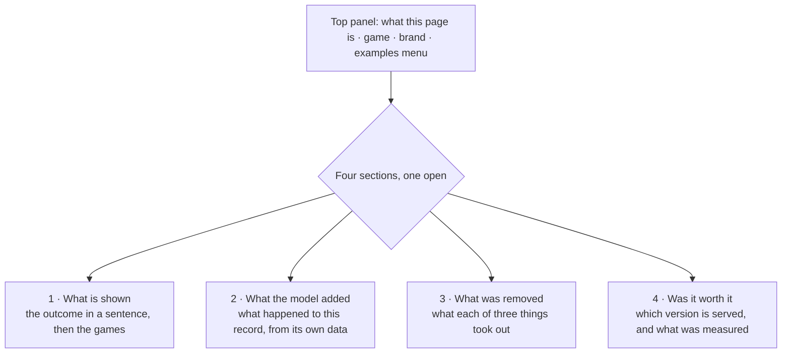

# Interface

**Status:** built, in the near-black and green look the owner chose for #4, in the layout he asked for: one page, four sections switched from a panel across the top. How it looks is not signed off: that is the owner's, and #4 stays open until he has looked.

**Purpose.** A page, served by the service at `/`, that opens the recommender up. It is the inspection view, not the screen a player would see, and it says so in its first line. A reader who has never seen the project should be able to follow it without help.

One section is open at a time. Each puts its question on the left, with a line on why it matters, and its answer for the chosen game and brand centre and right. The arrangement is a rule: [`ui-guidelines.md`](../ui-guidelines.md#how-the-page-is-arranged).

| Section | The answer, without opening anything | Folded under a named control |
|---|---|---|
| 1 · What is shown | "Given *game* on *brand*, the service returns *n* games that are live there and cleared the similarity floor, highest score first. It promises nothing more about them." Then each game with the labels it has in common with the game played. A decline takes the same place, with its reason in a sentence. A failure the evaluation lists for this request is said under the result | The exact scores and identifiers; index, version and timings |
| 2 · What the model added | One or two sentences on what the lookup table and the model did for this record; the supplier's structured fields; the labels the version holds; one phrase the model read | The supplier's text with every quoted phrase marked and numbered; the steps one by one with model and prompt names; the raw record |
| 3 · What was removed | A sentence counting what each of three things took out; then the trace's filters as three stages with the count left after each: which games may be shown at all (availability first), which are similar enough (the floor, and what the floor is), how many are shown. A step opens the list of what it removed | Every score against the floor |
| 4 · Was it worth it | Which version is served, whether it passes every pass mark, its measured pairwise accuracy, its model calls and estimated cost, and the best version built without the model; the four versions' accuracy and estimated cost; what the other versions return for this request; what the numbers do not show; the what-if button | The gate's own words and the owner's check; every pass mark; the numbers behind the table; accuracy by the condition of the record, with each version's model calls; the enrichment measures, the contradicted tags, the disagreements and the reviewer; the failures the evaluation found; the same request in every version |

- **The sentence over the results claims only what the service guarantees.** Each game is live on the brand and cleared the similarity floor. The page does not call them related: the evaluation's own rule grades some served results weak or unrelated.
- **What a result has in common with the game played** is the labels both records hold in the version shown. It is worded as what they share, and the page says the order cannot be traced to single labels.
- **A sentence about a record is read from that record.** What the lookup table found comes from the table's own step, whatever the version shown holds.
- **A failure the evaluation found is said where it was found:** in that version, and, when it is about a request, on that brand and with that result on the page.
- **A different list is not called a better list.** Which version ranks better rests on the evaluation's numbers. Costs are estimates and are labelled so.
- **The version picker** is at the foot of the page and defaults to the served version. Any other is marked "inspection" in the first section: the same core over another version of the index, never what a player is served.
- **The what-if panel changes no file.** A move sends one `GET /api/what-if` with the marks in the URL; the service applies the real gate to the measured numbers and writes nothing. The panel says that the release gate reads only `eval/thresholds.json`.
- **The address says what is open:** `/?game=<id>&brand=<brand>&version=<version>&section=<shown|added|removed|worth>`. `&focus=<id>` opens the step that removed that game and marks it, and `&open=versions` opens the comparison of versions. A game, brand or version is sent to the service exactly as written, so an unknown one is answered in the service's own words; a brand with no game shows the first game of the picker on that brand.
- **A late answer is dropped.** If a second request begins before the first has answered, only the second is shown.
- **While the owner's check is outstanding** the evaluation says how many of the reviewer's answers are held back and why, and shows none of them: it renders the report, and the report holds none. It says they are out of the working tree, which is what is true.
- **Nothing on the page is fixed in the code.** Every game, count, score, bar and tick is drawn from a response, so a rebuilt index or a re-run evaluation changes the page and no file under `src/console/`.

## The examples

Start it with `npm run serve` and open `http://127.0.0.1:8787`. If the port is taken: `npm run serve -- --port 9000`.

The page opens on the first example, at the first section. The Examples menu in the top panel offers seven, each with one line on what it shows; choosing one opens the section that shows it. Each is found by asking the service, so they follow the catalogue: a rebuild may change the game, and an example the data no longer holds is listed as not found. With the index and evaluation committed now they are:

| Example | What it shows | Address |
|---|---|---|
| A thin record gains labels | The supplier's tags gave no label; the model added six from the text | `/?game=ulv-26904&brand=tavrenmoor&section=added` |
| Already well described: the model adds nothing | The supplier's tags already gave every label the index holds | `/?game=drw-12933&brand=tavrenmoor&section=added` |
| A tag contradicts the description | The table asserts no mechanic; the model reads the text | `/?game=okk-17457&brand=tavrenmoor&section=added` |
| A plausible game is removed | The top result on one brand is withdrawn on the other, and is removed before anything is scored | `/?game=drw-21965&brand=tavrenmoor&section=removed&focus=thr-27417` |
| A decline instead of a guess | A record with nothing to compare on is declined, with the reason | `/?game=okk-78064&brand=tavrenmoor&section=shown` |
| The versions disagree | The four versions return different games for the same request | `/?game=okk-85222&brand=tavrenmoor&section=worth&open=versions` |
| A failure the evaluation found | A label the plan says can be recovered from the text, which the served version did not assert | `/?game=thr-86641&brand=tavrenmoor&section=shown` |

## Code

No build step, no framework and no dependency.

| Path | What it holds |
|---|---|
| `src/console/view.js` | Every view, as a plain function from the service's responses to HTML text: the four sections, the section links, the pickers' options, what an address asks for, the search for the examples, and the rule that keeps a late answer off the page. It touches no DOM, so the tests run it as it is |
| `src/console/view.d.ts` | Its types, for the tests |
| `src/console/app.js` | The glue: reads the controls, calls `GET /api/…`, puts a view's HTML on the page, switches sections, opens a step |
| `src/console/index.html`, `console.css` | The page, and the tokens, type, components and motion of [`ui-guidelines.md`](../ui-guidelines.md) |
| `src/console/console.test.ts` | The tests. Each name starts with the invariant it proves |
| `tools/console-check.ts` | The page in a real browser: what a reader sees without scrolling, and the checks the tests cannot reach. Needs a local Chrome and no package, and writes no file |

## Invariants

UI-8 and UI-13 changed with the layout and are restated here. UI-14 to UI-18 are new, from the review of #14. UI-10 moved to the fourth section. The others are unchanged.

| ID | Invariant | Proof command | Last proved |
|---|---|---|---|
| UI-1 | Everything the page shows for a request comes from the service's response to that request. The page asks only this service's own routes and makes no model call | `npm test -- "UI-1:"` | `7b4865d` |
| UI-2 | A declined request shows the reason for the decline and no results, and does not look like a failure. A link that names an unknown game reaches that decline | `npm test -- "UI-2:"` | `7b4865d` |
| UI-3 | The page is served, and for every brand and game in its pickers the trace renders without an error, in every version | `npm test -- "UI-3:"` | `7b4865d` |
| UI-4 | The what-if panel states that the gate reads only the committed file, shows each committed mark, flips pass and fail as a mark moves, and changes no file | `npm test -- "UI-4:"` | `7b4865d` |
| UI-5 | Text from the catalogue and from a model reaches the page as text, never as markup | `npm test -- "UI-5:"` | `7b4865d` |
| UI-6 | For a game whose tag contradicts its description, the page shows the conflict and how each version handled it | `npm test -- "UI-6:"` | `7b4865d` |
| UI-7 | A quote is marked where it sits in the record's own text, the one phrase shown alone is a quote of a label the model added, a quote that cannot be placed is said and not dropped, and a bar is as long as the number the response carries | `npm test -- "UI-7:"` | `7b4865d` |
| UI-8 | The page is four sections in a fixed order, one open at a time. Each states its question, why it matters and a sentence that answers it, with the detail folded away under controls with their own names. The section links carry the request and the section, and the page never calls itself a console | `npm test -- "UI-8:"` | `7b4865d` |
| UI-9 | What a result is said to have in common with the game played is held by both records, and is never offered as the cause of the score | `npm test -- "UI-9:"` | `7b4865d` |
| UI-10 | In the fourth section, what the other versions return is counted as the service answered, the measured quality and estimated cost are the report's, and a different list is not called a better one | `npm test -- "UI-10:"` | `7b4865d` |
| UI-11 | The path shows the trace's own counts in the trace's order, availability first, as three different things; says what the floor is; names a game that cleared the floor and is not shown; and points out a game at the step that removed it | `npm test -- "UI-11:"` | `7b4865d` |
| UI-12 | The examples are found in the data, each shows what it says and opens the section that shows it, no game is named in the page's files, and the examples change or say "none" when the data changes | `npm test -- "UI-12:"` | `7b4865d` |
| UI-13 | At 1280 by 640 and at 390 by 664, for every game on every brand in the served version and for each of the four sections, the line saying what the page is, the four section links, the section's question and the sentence that answers it are wholly on screen with no scrolling, and so is the first game of a result | `node tools/console-check.ts --first-screens` | `7b4865d` |
| UI-14 | The sentence over the results claims only what the service guarantees: live on the brand and above the similarity floor. It never calls the games related | `npm test -- "UI-14:"` | `7b4865d` |
| UI-15 | Every sentence about what happened to a record follows from that record's own data, in every version | `npm test -- "UI-15:"` | `7b4865d` |
| UI-16 | A failure the evaluation found is said only where it was found: in that version, and on that brand when it is about a request | `npm test -- "UI-16:"` | `7b4865d` |
| UI-17 | An answer that arrives after a newer request began is not shown | `npm test -- "UI-17:"` for the rule, `node tools/console-check.ts` for the page | `7b4865d` |
| UI-18 | A brand or a version an address names is sent as written, so the service says what is wrong with it. A brand with no game is kept | `npm test -- "UI-18:"` for the address, `node tools/console-check.ts` for the page | `7b4865d` |

**Exactly what UI-13 proves, and what it does not.** It is run in two windows: 1280 by 640, a short laptop window, and 390 by 664, a phone with the browser's bars taken off. In each it shows, through the page's own pickers and section links, all 100 games on all 3 brands in the served version, in each of the 4 sections: 1,200 views a window. It then arrives, with motion on, at `/` and at the address of each of the seven examples. "The answer" is the sentence at the top of the right column, or the whole decline; of the results only the first game has to be on screen. It does not hold in every window and is not meant to: a window shorter than 640 pixels, or narrower than 390, can push the answer down, and so can a version other than the served one on a phone, where the first section carries one more note.

What each proof does:

- **UI-1** gives the views a `get` that records every URL, and changes a score, a candidate's score and the floor in a response to see the changed numbers on the page.
- **UI-2** renders every declined request on every brand, and an unknown game, and looks for the reason code, the word "declined", no result and no red label.
- **UI-3** renders 1,200 traces and 300 comparisons through the service's own router.
- **UI-5** renders a response in which every string is a script tag, and every record whose delivered description carries markup.
- **UI-7** renders every game with the model's labels, strips the marks and their numbers from the text shown and compares it with the cleaned record, then plants a quote that is nowhere in the record and changes a score and the floor.
- **UI-8** renders every game and an unknown game on every brand and looks at the four sections of each.
- **UI-9** asks the service for both records of every result on the home brand and compares the labels shown with the labels both hold.
- **UI-10** asks the service for every other version's answer to every game and recounts the overlap; the measured numbers are compared with the report's.
- **UI-11** renders every game on every brand against its trace.
- **UI-12** checks each example against the service rather than against what the finder says, removes the chosen game to see the example move, and removes every thin record to see it say "none".
- **UI-14** reads the sentence on every page that has results, and checks that each game under it is live on the brand and at or above the floor.
- **UI-15** reads the sentence for every game in every version that holds labels, against what the table found, what the version holds and whether the model was used.
- **UI-16** renders every game the evaluation lists a failure for, on every brand in every version.
- **UI-17** runs a slow request and then a fast one through the rule the page uses. The browser check does the same on the page, with 100 ms of network delay.
- **UI-18** sends a brand and a version in the wrong case and reads the service's refusal. The browser check opens those addresses.

Each fix from the review was undone on purpose, one at a time, and its proof failed: UI-14, UI-15, UI-16, UI-17 and UI-18 in the tests, and UI-17 on the page. So were two faults for UI-8 (two sections open, a section with no answer), a question pushed down for UI-13, a section opened beside the last one, a long word allowed to widen a narrow window, the focus rule removed and the reduced-motion rule ignored.

**What the tests do not reach, and what does.** They run the views, not a browser: `app.js`, the 240 lines that wire controls to views, is outside `npm test`. `node tools/console-check.ts` drives the page in headless Chrome at both sizes, and besides UI-13, UI-17 and UI-18 fails when:

- an example, once opened, does not show what it says;
- a section link does not open its section alone, loses focus, arrives with no transition, or its address does not open the same view;
- the examples menu is open on arrival, does not offer an example the data holds, or stays open after a choice;
- a step of the path does not open what it removed, or two are open at once;
- anything is wider than the window, with every drawer open, at each of the two sizes and at 320 pixels wide;
- a control reached with Tab shows no focus ring;
- the what-if panel cannot be opened and moved with the keyboard alone, does not say what the gate reads, loses focus when redrawn, or a file under `eval/` or `data/` has changed after the move;
- the page script raises an error;
- anything still animates under `prefers-reduced-motion`.

It is run by hand, because a machine without a browser cannot run it, and its result for a change is in that change's pull request. `--base <url>` runs it against a service that is already running.

How the page looks and feels is not an invariant and has no proof command. The owner judges it by opening it.
