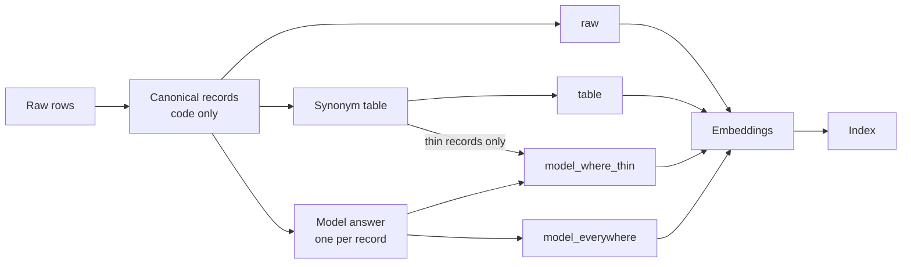

# Pipeline

**Status:** built. 100 games from 104 raw rows, four versions of each game's text, 400 embeddings, one index.

**Purpose.** The offline steps that turn the raw catalogue into what the service reads. Code alone makes a canonical record from each game's raw rows. Four versions of the game's text are then built, embedded and written to a versioned, hashed index. Every model call in the product happens here, and every response is stored, so nothing downstream needs a key.



## The four versions

What they are for is in [`eval/refs/evaluation-plan.md`](../../eval/refs/evaluation-plan.md): a ladder, compared rung by rung.

| Version | Text that is embedded | Model calls |
|---|---|---|
| `raw` | Title, description and the three tag lists exactly as delivered | none |
| `table` | Cleaned title and description, plus the labels the synonym table found in the tags | none |
| `model_where_thin` | The same, plus the model's labels on thin records only | thin records |
| `model_everywhere` | Cleaned title and description, plus the model's labels only | every record |

- **One stored answer per record serves both model versions.** The model is asked once per record, and the request never depends on the table. `model_where_thin` reads the answer only for thin records, and its cost on record is the cost of those calls alone.
- **Thin** (`thin-v1`, in `versions.ts` and in the manifest): the table leaves the record's themes or its mechanics without a usable label, because no delivered tag mapped to that field or because the mechanics tags are in conflict. The rule reads the raw record and the table's output and nothing else. 31 of 100 records are thin.
- **Conflict.** A tag maps to one win system (paylines, ways or cluster pays) and the description names a win system but not that one; or the labels of one record assert two win systems. The mechanics field then holds no label in any version and adds nothing to the text. 5 records.
- **What a conflict costs the two model versions.** On those 5 games the rule also withholds the model's own mechanics: 17 labels, every one quoted from the description, and in all 5 the model had followed the description's win system and not the tag's. So `model_where_thin` and `model_everywhere` carry themes only on those games, and the ladder cannot show there whether the model resolves a contradiction that the table cannot. The labels are not lost: they stay in each record's `model` entry.
- **A field with no label adds no line to the text.** Its status says why: `abstained` or `conflict`.

## Code

| Path | What it holds |
|---|---|
| `src/pipeline/canonical.ts` | Raw rows to canonical records. No model, and no import of anything that calls one |
| `src/pipeline/synonyms.ts` | The synonym table, and the shape of a label with its quote and provenance |
| `src/pipeline/versions.ts` | The four versions, the thin rule, the conflict rule |
| `src/pipeline/enrich.ts` | The model request, the check of its answer, the stored attempts and their replay |
| `src/pipeline/embed.ts` | The embedding request, its stored response and its replay |
| `src/pipeline/index-store.ts` | Writing the index, and `loadIndex`, which validates all of it |
| `src/pipeline/report.ts` | The ledger and the build report |
| `src/pipeline/costs.ts` | Prices, the spend limit, the HTTP call |
| `src/pipeline/io.ts` | The one way the pipeline reads a file; refuses the hidden truth directory |
| `src/pipeline/build.ts` | The command |
| `src/pipeline/pipeline.test.ts` | The tests. Each name starts with the invariant it proves |
| `prompts/enrich-v1.md` | The enrichment prompt. The vocabulary and its meanings are appended from `src/dataset/vocabulary.ts` |

## Data

| Path | What it is |
|---|---|
| `data/pipeline/responses/enrichment/<prompt version>/<game id>.json` | Every stored model attempt for one record: outcome, seconds, tokens, and the body as received |
| `data/pipeline/responses/embeddings/<version>.json` | The stored embedding response for one version's 100 texts |
| `data/index/` | The index. Everything the service and the console read from the pipeline |

A new prompt version gets a new directory, so the answers to an earlier prompt are kept and still counted in what was spent.

## The index

| File | Contents |
|---|---|
| `manifest.json` | `format_version`, `index_hash`, the catalogue's SHA-256 and row counts, both model ids, the prompt version and the hash of the prompt as sent, `dimensions`, the version names, the thin rule, the game ids in row order, and the size and SHA-256 of every other file |
| `records.jsonl` | One line per game, sorted by game id |
| `vectors.<version>.f32` | One vector per game in the same order: 1,536 little-endian 32-bit floats each, unit length as the provider returns them |
| `ledger.json` | Calls, tokens, estimated cost and seconds per version, and what was spent in total |
| `report.json` | Tags mapped, dropped and unknown; conflicts; thin records; model answers by outcome; labels stripped by reason |

`index_hash` is the SHA-256 of the manifest without that key. It changes when anything in the index does, so it names one index.

One record holds:

- `canonical`: the game as code alone reads it from the raw rows. Title, description (cleaned, and as delivered), provider, family, the two attribute tag lists and the merchandising list verbatim, the facts verbatim, and which raw row it came from.
- `evidence`: `description`, `tags_only` or `none`. `none` means no description and no tag the table maps: the record is too thin to use, and the service is expected to decline on it.
- `table`: the table's labels, the tags it dropped and the tags it did not know.
- `conflict`, `thin`: the two rules above, applied to this record.
- `model`: the model's checked labels for this record, and what was stripped from its answer and why.
- `versions.<version>`: the `text` that was embedded, and for every version but `raw` the `themes` and `mechanics` fields. Each label carries `quote`, `source_field` (`title`, `description`, `features` or `themes`), `method` (`synonym_table` or `model`), and for a model label the `model` and `prompt_version`.

To load it:

```ts
import { loadIndex } from "./src/pipeline/index-store.ts";

const index = loadIndex("data/index", { cataloguePath: "data/catalogue.raw.jsonl" });
const row = index.manifest.game_ids.indexOf("ulv-17288");
const record = index.records[row];
const vector = index.vectors.table.subarray(row * 1536, (row + 1) * 1536);
```

`loadIndex` is the only way in. It throws unless every check of PL-4 passes, and with `cataloguePath` unless the index was built from that file. Availability is not in the index: it is read from `data/offerings.jsonl`, whose `game_id` is the record's `game_id`.

## Commands

```sh
npm run pipeline                                     # rebuild the index from the stored responses: no key, no network
npm run pipeline -- --validate                       # load the committed index and check all of it
OPENAI_API_KEY=... npm run pipeline -- --live        # also call the models where no response is stored
OPENAI_API_KEY=... npm run pipeline -- --live --limit 5   # enrich five records and print the answers; writes no index
npm test -- "PL-4:"                                  # the tests of one invariant
```

A live run stops before any call that could take the total past `--max-usd` (default 2.50). The total starts from what the stored responses already cost, so the limit holds across runs.

## Record model: the open questions, answered

`data/README.md` lists what the catalogue had to assume. The pipeline's answers:

| Question | Answer | Where |
|---|---|---|
| What mints `game_id`? | The supplier game code, confirmed. Two rows with one code are one game | `canonical.ts` |
| How are the three tag lists carried? | **Changed.** `features` and `themes` stay two lists, verbatim and in delivered order, because a label's provenance names the list its tag came from. Merchandising `tags` are kept apart and never looked up | `canonical.ts`, `synonyms.ts` |
| Do quotes match the raw or the cleaned description? | The cleaned one, confirmed. The model is shown the cleaned text, and the index stores it, so a quote can be found and shown. Table quotes are whole tags as delivered | `enrich.ts` |
| Which row of a duplicate wins? | The later `fetched_at`, confirmed. The other row's id is recorded. Two rows fetched at the same time stop the build | `canonical.ts` |
| What is the cleaned title? | The delivered title without trademark signs and with spaces collapsed. Case is left alone | `canonical.ts` |
| Is a family inferred? | No, confirmed. `family_id` is what the feed supplied, or null | `canonical.ts` |
| What does a missing description mean? | Absent, null, empty and blank all mean no description, confirmed | `canonical.ts` |
| A non-English description? | Kept as delivered, confirmed. Labels are vocabulary terms and a quote is in the language of the text | `prompts/enrich-v1.md` |
| Do facts in a description count? | They are left in the text, confirmed. The facts of record are separate and never parsed | `canonical.ts` |
| When is a record too thin to use? | **Changed.** When it has no description and no tag the table maps: `evidence: none`, 7 records, not only the 4 near-empty rows. It is still indexed; declining is the service's decision | `versions.ts` |
| Is a tag that contradicts a raw fact a conflict? | No, confirmed. Facts are never read. Only a win-system tag that the description contradicts is a conflict | `versions.ts` |

## Invariants

| ID | Invariant | Proof command | Last proved |
|---|---|---|---|
| PL-1 | Canonical facts are written by code only. A model answer has no place for a fact or an availability status, and one that carries either is rejected whole | `npm test -- "PL-1:"` | `7108ffa` |
| PL-2 | Every label is a term of its field's vocabulary and carries a quote found word for word in the field it names, as whole words, with its provenance. Anything else is stripped and counted | `npm test -- "PL-2:"` | - |
| PL-3 | A refusal, a cut-short answer, malformed output and an API error are each rejected and counted under their own name. None is repaired | `npm test -- "PL-3:"` | `7108ffa` |
| PL-4 | The index carries its version, model ids, prompt version, dimensions, catalogue hash and thin rule. Loading fails on a non-finite value, a wrong dimension, misaligned ids, a hash mismatch, an altered quote or another catalogue | `npm test -- "PL-4:"` | - |
| PL-5 | The synonym table maps delivered tags onto the 24 labels by lookup. Non-attribute and merchandising tags are dropped. A tag it does not know is counted and listed, never guessed | `npm test -- "PL-5:"` | `7108ffa` |
| PL-6 | The model's answers do not reach the `raw` or `table` version, and reach `model_where_thin` on thin records only. The thin rule is recorded in the index | `npm test -- "PL-6:"` | `7108ffa` |
| PL-7 | A field whose tags and description conflict has no label and adds nothing to any version's text | `npm test -- "PL-7:"` | `7108ffa` |
| PL-8 | All four versions of every game have an embedding of 1,536 dimensions from the same model | `npm test -- "PL-8:"` | `7108ffa` |
| PL-9 | Rebuilding with no key over the stored responses reproduces the committed index byte for byte | `npm test -- "PL-9:"` | `7108ffa` |
| PL-10 | The pipeline never reads the hidden truth directory | `npm test -- "PL-10:"` | `7108ffa` |
| PL-11 | A stored response that is stale, damaged or missing stops the rebuild, names the file and writes nothing | `npm test -- "PL-11:"` | `7108ffa` |
| PL-12 | The ledger reports calls, tokens, estimated cost and seconds per version, and a live run stops before the call that could pass the spend limit | `npm test -- "PL-12:"` | `7108ffa` |

The colon in the pattern matters: without it `PL-1` also matches PL-10 to PL-12.

What each proof does:

- **PL-1** sends answers carrying `rtp`, a `facts` object, a `status` inside a label and an `availability` list, and expects each rejected whole; it checks that the schema sent to the model is closed to two keys. It rebuilds the index and compares every canonical record with what the canonicaliser alone makes of the raw rows, and every fact with the delivered value.
- **PL-2** answers with a label outside the list, a mechanic in the themes field, an invented quote, real words attributed to the wrong field, part of a tag, an empty quote and a repeated label, and expects each stripped under its reason and counted. It takes quotes that start or end inside a word, such as "ri" from "riddles", and expects each refused, beside whole-word quotes at the start, the end and before punctuation that must pass. It then re-checks every label of the rebuilt index with its own whole-word test, not the pipeline's.
- **PL-3** feeds a refusal, a cut-short answer and nine malformed answers that a lenient reader could have fixed. Through a transport that needs no network it plays a server error, a refusal and a cut-short answer for one record, and checks the three stored attempts, their counts, and that the record ends with no labels; then an error a retry cannot cure, and one that keeps coming.
- **PL-4** corrupts a copy of the index ten ways, one of them a quote cut to a piece of a word. For the faults a file hash would catch first, it brings the hashes up to date so that the deeper check has to catch them.
- **PL-5** runs the table over tags it knows, near-misses, non-attributes and merchandising labels, and checks that all 24 labels are reachable and that every delivered tag is accounted for.
- **PL-6** builds every record twice, with no model labels and with loud ones, and compares the versions; then checks every record of the rebuilt index against the rule restated in the test.
- **PL-7** builds one record with and without the contradiction, so that the control shows the same tags do reach the text otherwise.
- **PL-8** compares each vector of the rebuilt index with the stored response, and breaks a stored response three ways.
- **PL-9** copies the catalogue and the stored responses to a scratch directory, runs the build there twice with no key in its environment, and compares all eight files with the committed ones.
- **PL-10** runs the build in a tree that has no `generation` directory at all and gets the committed manifest, and checks that the reader refuses a path inside the real one.
- **PL-11** breaks a scratch copy six ways: a changed record, a cut-short file, an answer edited to carry a fact, a missing answer, embeddings of other texts, missing embeddings.
- **PL-12** adds up the stored responses itself and compares with the ledger of a rebuild; then runs a live build through the network-free transport under a limit it cannot fit in, and checks where it stopped, what it kept, and that the key it was given is in no file.

Each proof was also checked the other way: 27 one-line breaks of the pipeline code were tried, one at a time, to see the matching proof fail. 25 failed at once. One did not, because the proof read the committed index instead of running the code; the proofs over the whole index now rebuild it first. The other was a badly made break that showed only on some runs; made to show on every run, it fails PL-9.

A fresh review then found a fault none of those breaks had: the quote check was a substring test, so it took a piece of a word for a quote. No stored label was affected and the index did not change. The check now requires whole words, and PL-2 and PL-4 fail without that.

## Known limits

- **No bad output came back in the live run.** All 100 answers were accepted and no label was stripped. The handling of a refusal, a cut-short answer, malformed output, a label outside the list, an invented quote and an API error is proved on constructed responses only.
- **A verbatim quote is not a good quote.** Code checks that the words are in the field as whole words, not that they support the label. Whether the labels are right is the evaluation's question.
- **The synonym table was written against this catalogue's tags.** It knows all 105 spellings here, so nothing is unknown in this build. A new feed will bring spellings it does not know.
- **The conflict rule reads English only**, by phrase. A contradiction in one of the five German descriptions is not seen. A conflict blanks the whole mechanics field, including features that were not in dispute and the model's labels; "The four versions" says what that costs.
- **`raw` is exempt from the conflict rule.** It is the delivered text, contradiction included; it has no descriptor fields to blank.
- **Boilerplate is not detected.** A filler description counts as a description, in the text and in `evidence`.
- **Costs are estimates:** reported tokens at list price, read on the date recorded in `ledger.json`. Seconds are call durations added up; calls ran eight at a time, so they are not time on the clock.
- **A failed embedding call leaves no record.** It reports no usage and costs nothing, but it is not counted.
- **The hidden-truth guard matches a directory name.** A checkout under a directory called `generation` would be refused in full.
