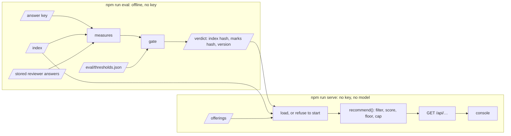

# Service and evaluation

**Status:** built. The evaluation passes `model_where_thin`, and the service serves it. The owner's six check answers are outstanding.

**Purpose.** The service answers "related games" for one game on one brand from the index, removing everything the brand cannot offer before ranking, and declines when nothing good enough remains. The evaluation scores the committed outputs against the owner's plan and pass marks, and its verdict decides which version of the index the service serves, or that it serves none.



## One request

`recommend(state, { gameId, brand, limit, trace })` in `src/service/recommend.ts` is a plain function. Its steps, in the order the code runs them and the trace reports them:

| Step | What happens | Declines with |
|---|---|---|
| 1 | Look the game up | `unknown_game` |
| 2 | The game must be live on the brand | `anchor_not_available` |
| 3 | Its record must have a description or a mapped tag (`evidence` is not `none`) | `insufficient_data` |
| 4 | **Remove every game that is not live on the brand.** Nothing has a score yet | |
| 5 | Remove the game itself, and a second record of it: same studio and same title | |
| 6 | Remove records with `evidence: none` | |
| 7 | Score what is left against the game: the dot product of two unit vectors, rounded to six places. Rank | |
| 8 | Remove everything below the similarity floor | `nothing_above_floor` |
| 9 | Keep at most one game of the anchor's own family, the best one | |
| 10 | Cut to the limit: 5 by default, 10 at most | |

- **The floor is a rule, not a chosen number:** `floor-p90-v1`, the similarity that 90% of all pairs of games in the served version fall below. It reads the vectors only. It was committed before the evaluation had produced any result, and the verdict records the floor it judged.
- **A decline is a 200** with `outcome: "declined"`, a reason code and no results. **Bad input is a 400:** a missing or repeated parameter, an unknown parameter, a limit outside 1 to 10, an unknown brand.
- **A trace**, on `trace=1`, carries the record as delivered, what the table and the model each added with the quote behind every label, every filter with what it removed, every scored candidate, the floor, the outcome and the time each stage took.

## Routes

All are `GET`. Any other method is a 405. Nothing writes a file.

| Route | Returns |
|---|---|
| `/api/recommendations?game=&brand=[&limit=][&trace=1]` | Results or a decline, from the version the evaluation chose |
| `/api/inspect?game=&brand=&version=` | The same core over any of the four versions, with a trace. For the console's comparison; never what a player is served |
| `/api/catalogue` | Brands, games and each game's status per brand, for the console's pickers |
| `/api/evaluation` | The verdict, the committed pass marks and the evaluation report, as read at the start |
| `/api/what-if?min_precision=…` | The real gate applied to the measured numbers with the marks given in the request. Marked `what_if`; changes nothing |
| `/` | The console |

## Starting, and refusing to start

`loadService` in `src/service/state.ts` refuses, with the reason in words, when:

- the index does not pass `loadIndex`, or was built from another catalogue;
- the offerings file is empty, has a malformed line, or lists a game twice for one brand;
- there is no verdict, or it cannot be read;
- the verdict is for another index hash, was reached with other pass marks than `eval/thresholds.json` now holds, judged another floor, or does not match its report;
- the verdict does not pass.

Offerings are read at the start. The verdict is not bound to them, so a game withdrawn there is gone at the next start with no new evaluation.

## The evaluation

`npm run eval` scores the committed index against the answer key in `data/generation/`, replays the reviewer's stored answers, applies `eval/thresholds.json`, and writes two files:

| File | What it is |
|---|---|
| `eval/results/<prompt version>/report.json` | Every measure with its counts, the reviewer's answers, the check games, the gallery |
| `eval/results/verdict.json` | Which version ships, for which index hash and which pass-mark file. The service reads only this |

It exits 0 when a version may be served, and 1 when no version passes its marks or an input is missing or stale. One version failing while another ships is exit 0: the ladder is built for that.

Every definition is in [`eval/refs/evaluation-plan.md`](../../eval/refs/evaluation-plan.md), and every pass mark in `eval/thresholds.json`. Neither is restated here or in code: `eval/gate.ts` holds the shape of the file and no value, and the reviewer's two questions are read out of the plan file at run time.

### Result on the committed index

The index is the one named in `eval/results/verdict.json`. The numbers below are from `report.json`, which EV-1 checks against a fresh run.

**1. Is enrichment safe to automate?**

| Version | Precision | Recovery | Recovery without tags | Missed abstentions | Invalid quotes | Marks |
|---|---|---|---|---|---|---|
| Synonym table | 380 of 380 | 380 of 442 (86.0%) | 0 of 50 | 0 of 11 | 0 of 380 | fails recovery without tags |
| Model where thin | 440 of 440 | 440 of 442 (99.5%) | 48 of 50 (96.0%) | 0 of 11 | 0 of 441 | pass |
| Model everywhere | 438 of 438 | 438 of 442 (99.1%) | 50 of 50 | 0 of 11 | 0 of 439 | pass |

- Raw text asserts no labels, so these marks do not apply to it.
- The table can never pass recovery without tags: it reads tags only.
- One label in 441 is outside the plan (`adventure` on `qfi-77843`). It is left out of precision because the reviewer's answer counts as unclear.
- On the five games where a tag contradicts the description, the table version asserts no mechanic (17 recoverable labels) and the two model versions carry the model's reading, with none of those labels missed.

**2. What does each step add to matching, and what does it cost?**

| Version | Pairwise, pooled | Mean per game | Wrongly shown | Model calls | Est. cost | Marks |
|---|---|---|---|---|---|---|
| Raw text | 76.0% (64,217 of 84,488) | 78.6% | 0 of 24 shown | 0 | $0.0002 | pass |
| Synonym table | 76.6% (64,705) | 79.4% | 0 of 25 | 0 | $0.0001 | pass |
| Model where thin | 80.5% (68,013) | 82.8% | 0 of 24 | 31 | $0.1160 | pass |
| Model everywhere | 80.1% (67,663) | 82.1% | 0 of 25 | 100 | $0.3908 | pass |

Mean per game, by the condition of the record asked about:

| Version | Has a description (63) | Tags only (30) | Nearly empty (7) | Thin (31) | Not thin (69) |
|---|---|---|---|---|---|
| Raw text | 80.5% | 75.7% | 73.8% | 76.7% | 79.4% |
| Synonym table | 81.1% | 76.7% | 75.6% | 77.9% | 80.0% |
| Model where thin | 83.3% | 81.8% | 82.3% | 82.1% | 83.1% |
| Model everywhere | 82.7% | 80.8% | 82.2% | 82.1% | 82.1% |

**What ships: `model_where_thin`.** It has the best pairwise accuracy of the versions that pass (0.805), so it is within the 0.02 margin of itself; raw text passes but is 0.045 below, outside the margin; the table fails an enrichment mark. The model earns its place on 31 calls, and asking it about all 100 records buys nothing more.

**The reviewer** (`gpt-6-luna`, 26 questions, $0.0013):

- Control: it agreed with the plan on 18 of 20: 10 of 10 where the label applies, 8 of 10 where it does not. One of the two was a "yes" whose quote was the label's meaning, not the record's words, so it was recorded as unclear.
- Recommendation questions: it said yes to all 5 results the rule calls unrelated. **Zero wrongly shown therefore rests on a reviewer that did not once say no to a recommendation.** Read that mark with this beside it.
- Owner's check: outstanding. Only one disagreement exists, so five of his six questions come from the control sample.

### Readings chosen where the plan leaves a detail open

Each is the stricter reading, was fixed in a commit before the first run, and is enforced by the test named.

| Detail | Reading | Proof |
|---|---|---|
| Which marks apply to raw text | The enrichment marks apply to a version that asserts labels. Raw asserts none, so only the matching marks apply | EV-3 |
| Pairwise accuracy is reported two ways | For the pass mark and the ship rule a version's figure is the lower of pooled and mean per game | EV-4 |
| "The best", "the cheapest" | The best among the versions that pass. Cheapest is the ladder's order | EV-3 |
| A rate over nothing | Fails its mark | EV-3 |
| Word for word | The same characters, beginning and ending on a word boundary. The evaluation has its own check and does not call the pipeline's. A label's quote is checked against the field it names; the reviewer's against the delivered text it was shown | EV-4, EV-5 |
| A label the plan calls unknowable | A disagreement: the reviewer is asked and its answer listed. Left out of precision, as the plan's definition says. None occurred | EV-4 |
| The control sample | Ten labels the plan calls recoverable and all three label versions assert; ten the plan never assigned and none asserts. Agreement is "yes" on the first and "no" on the second; "unclear" is not agreement | EV-5 |
| The check games | Six drawn by seed from the games live on the largest brand whose record is not nearly empty. The same six for every version, each judged on what the service core returns for that version | EV-4 |
| Record condition | The index's own `evidence` field: has a description, tags only, nearly empty. Filler counts as a description. Thin and not thin are reported beside it | EV-4 |
| The owner's six | Every disagreement, then the control sample, each drawn by seed. Until he has answered, the reviewer's answers to them are withheld from the report | EV-6 |
| When the command fails | When no version passes, or an input is missing. Not when one rung of the ladder fails | EV-1 |
| The blanks in the questions | `{name}` is the label with spaces for underscores; the text shown is the record as delivered | EV-5 |

One seed, `evaluation-v1`, drives every draw.

## Code

| Path | What it holds |
|---|---|
| `src/service/recommend.ts` | The core: the ten steps, the floor rule, the trace |
| `src/service/offerings.ts` | The one reader of availability |
| `src/service/verdict.ts` | The verdict's shape and its reader |
| `src/service/state.ts` | Loading everything, and every refusal to start |
| `src/service/http.ts` | `route`: a method and a URL to a reply. The socket is ten lines around it |
| `src/service/serve.ts` | The command |
| `eval/truth.ts` | The answer key, and the grade of a pair of games |
| `eval/measures.ts` | The enrichment and matching measures, and the word-for-word check |
| `eval/gate.ts` | The pass marks applied to the measures; the ship rule |
| `eval/reviewer.ts` | The questions read from the plan, the request, the stored answers, the spend limit |
| `eval/evaluate.ts` | `analyse` and `finish`: the evaluation as two pure steps around the reviewer's answers; the gallery |
| `eval/run.ts` | The command |
| `eval/owner-check.ts` | The owner's six questions at a terminal |
| `eval/reviewer/answers/` | Every stored reviewer attempt: outcome, tokens, the body as received |
| `src/service/service.test.ts`, `eval/eval.test.ts` | The tests. Each name starts with the invariant it proves |

## Commands

```sh
npm run eval                 # score, write the report and the verdict: no key, no network
npm run serve                # http://127.0.0.1:8787, console at /
npm run serve -- --port 9000
npm run owner-check          # the owner, at a terminal: six questions, written to eval/refs/owner-check.json
OPENAI_API_KEY=... npm run eval -- --live    # ask the reviewer any question with no stored answer; stops before $1.00 in total
npm test -- "SV-1:"          # the tests of one invariant
```

The owner's check: run `npm run owner-check`, answer y, n or u to each question, then `npm run eval` and commit `eval/refs/owner-check.json` with the updated `eval/results/`. The command never shows the reviewer's answers, refuses to run without a terminal, and is the only code that writes under `eval/refs/`.

## Invariants

| ID | Invariant | Proof command | Last proved |
|---|---|---|---|
| SV-1 | Availability is filtered before ranking: for every game on every brand, no result is a game that is not live on that brand, and no such game is ever scored | `npm test -- "SV-1:"` | - |
| SV-2 | Serving a request makes no model call: it opens no connection, and the service runs from a tree with no hidden truth and no model response | `npm test -- "SV-2:"` | - |
| SV-3 | At most one result comes from the anchor game's own family, and a duplicate of the anchor is never returned | `npm test -- "SV-3:"` | - |
| SV-4 | When nothing eligible is good enough, the response is a decline with one of four reason codes and no results, not a weaker list. Every result clears the floor | `npm test -- "SV-4:"` | - |
| SV-5 | The service refuses to start on an invalid index, and without a passing verdict bound to that index's hash, to the committed pass marks and to the floor it judged. It serves the version the verdict chose, and a what-if changes none of that | `npm test -- "SV-5:"` | - |
| SV-6 | A game withdrawn in the offerings file is gone after a restart, and other results are still served. A malformed offerings file stops the start | `npm test -- "SV-6:"` | - |
| SV-7 | A trace carries the record, what each step added with its quote, what each filter removed, the scores, the floor, the outcome and per-stage timings | `npm test -- "SV-7:"` | - |
| SV-8 | Bad input is a 400 that says what was wrong, a decline is a 200, and only GET is answered | `npm test -- "SV-8:"` | - |
| EV-1 | The evaluation runs without a key over committed outputs, reproduces the committed report and verdict byte for byte, and exits non-zero when the gate fails or an input is missing or stale | `npm test -- "EV-1:"` | - |
| EV-2 | Every pass mark is read from the owner's file. None is defined in code, and a file the gate does not fully understand is refused | `npm test -- "EV-2:"` | - |
| EV-3 | The ship rule picks the simplest passing version within the margin of the best passing one, and nothing when none passes | `npm test -- "EV-3:"` | - |
| EV-4 | Each measure is the plan's: precision, recovery, recovery without tags, missed abstentions, invalid quotes, the grade of a pair, pairwise accuracy. Counts stand beside rates | `npm test -- "EV-4:"` | - |
| EV-5 | The reviewer is asked the plan's own question text, never told who asserted a label, and its "yes" counts only with a word-for-word quote; otherwise it is recorded as unclear. The control is reported as a count | `npm test -- "EV-5:"` | - |
| EV-6 | With no owner's answers the evaluation still reaches its verdict, says the check is outstanding, and withholds the reviewer's answers to his six questions | `npm test -- "EV-6:"` | - |
| EV-7 | A live reviewer call is refused before it could pass the spend limit of $1.00, every attempt is stored, and the key reaches no file | `npm test -- "EV-7:"` | - |
| EV-8 | The gallery holds three to five real failures from the system's own output, apart from the mess that was planted | `npm test -- "EV-8:"` | - |

What each proof does:

- **SV-1** asks every game on every brand in every version, 1,200 requests, and checks each result and each scored candidate against the offerings file as the test itself reads it. It then withdraws the game that ranks first for one anchor and checks that it has no score, for each status that is not `live` and for a game with no row.
- **SV-2** replaces `fetch`, the socket's `connect` and the name lookup with tripwires, removes the key from the environment, answers every game on every brand through the router, and then checks that the tripwires do fire. It also starts the service from a scratch tree that holds only the index, the catalogue, the offerings, the verdict and the pass marks.
- **SV-3** checks every real request, then puts three top results into the anchor's family and expects one, and gives one result the anchor's studio and title and expects it gone. The real catalogue cannot trigger the cap: every family has two members.
- **SV-4** finds one request for each of the four reasons by asking, checks every request for floor, order and counts, and recomputes the floor from all pairs.
- **SV-5** breaks a scratch copy ten ways: no verdict, unreadable, malformed, failed, failed but still naming a version, contradicting itself, another index, other pass marks, another floor, another report. It breaks the index two ways and runs the command to see exit 1 and the reason.
- **SV-6** withdraws one game in a scratch offerings file, loads again, and asks every game on that brand.
- **EV-1** runs the command twice with no key and compares the report and the verdict with the committed files. It removes the stored answers, the answer key and the pass marks in turn, and makes one stored answer stale. It then scrambles every vector of a scratch index, re-seals it, runs the command on it to exit 1, and starts the service on the verdict that run wrote, which refuses.
- **EV-2** moves each of the seven marks, one at a time, just past what was measured, in a copy of the file, and expects exactly that mark to fail.
- **EV-4** grades seven constructed pairs both ways round, scores a five-game toy index whose answer is known, then changes the real index in memory four ways: an invented quote, a quote cut from inside a word, a label on a field that should be silent, every label removed. It recounts recovery by hand.
- **EV-5** gives the reviewer's reader a true quote, two stitched phrases, an empty quote, other capitals, a piece of a word and the label's own meaning.
- **EV-7** plays a live call through a stand-in for the network at the limit, with two unreadable answers, and with a rejected key.

Each proof was also checked the other way: 26 one-line breaks of the code were tried, one at a time. 25 turned their proof red at once. One did not: dropping the check that a verdict passed stayed green, because the test's failed verdict also named no version. That case is now its own.

## Known limits

- **Zero wrongly shown rests on a lenient reviewer.** It answered yes to all five recommendation questions, including a pair it said had "paylines, RTP range and Hot tag" in common. The owner's six answers do not test this: they are label questions.
- **The owner's check is outstanding**, and five of its six questions come from the control sample because only one disagreement exists.
- **The answer key, the catalogue text, the enrichment and the reviewer all come from one vendor's models.** Related models can share blind spots. The plan says so; so does the README.
- **The family cap sees only the family the feed states.** The feed states four of the nine families. Each has two members, so on this catalogue the cap can never remove anything; it is proved on a constructed index only.
- **A duplicate is "same studio and same title".** The index has one record per game code, so none exists here; this too is proved on a constructed index.
- **The floor costs recall.** One game with five strongly related games live on the largest brand is declined because none clears it. It is in the report's gallery.
- **"Has a description" includes filler.** The index does not detect boilerplate, so the split by record condition is blunter than the plan's wording.
- **The reviewer's live path** has run once, for the 26 stored answers, with no refusal, cut-short answer or API error. Their handling is proved on constructed responses.
- **Costs are estimates:** reported tokens at list price, read on the date in the code.
- **Nothing here was run on Windows or on a Node version other than 24.**
