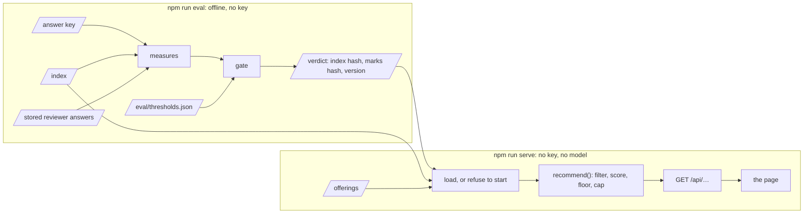

# Service and evaluation

**Status:** built. The evaluation passes `model_where_thin`, and the service serves it. The owner has answered his six check questions, the reviewer's answers to them are back in the tree, and nothing is held back.

**Purpose.** The service answers "related games" for one game on one brand from the index, removing everything the brand cannot offer before ranking, and declines when nothing good enough remains. The evaluation scores the committed outputs against the owner's plan and pass marks, and its verdict decides which version of the index the service serves, or that it serves none.



## One request

`recommend(state, { gameId, brand, limit, trace })` in `src/service/recommend.ts` is a plain function. Its steps, in the order the code runs them and the trace reports them:

| Step | What happens | Declines with |
|---|---|---|
| 1 | Look the game up | `unknown_game` |
| 2 | The game must be live on the brand | `anchor_not_available` |
| 3 | Its record must have a description or a mapped tag (`evidence` is not `none`) | `insufficient_data` |
| 4 | **Remove every game that is not live on the brand.** Nothing has a score yet | |
| 5 | Remove the game itself, and a second record of it: same studio and same title | |
| 6 | Remove records with `evidence: none` | |
| 7 | Score what is left against the game: the dot product of two unit vectors, rounded to six places. Rank | |
| 8 | Remove everything below the similarity floor | `nothing_above_floor` |
| 9 | Keep at most one game of the anchor's own family, the best one | |
| 10 | Cut to the limit: 5 by default, 10 at most | |

- **The floor is a rule, not a chosen number:** `floor-p90-v1`, the similarity that 90% of all pairs of games in the served version fall below. It reads the vectors only. It was committed before the evaluation had produced any result, and the verdict records the floor it judged.
- **A decline is a 200** with `outcome: "declined"`, a reason code and no results. **Bad input is a 400:** a missing or repeated parameter, an unknown parameter, a limit outside 1 to 10, an unknown brand.
- **A trace**, on `trace=1`, carries the record as delivered, what the table and the model each added with the quote behind every label, every filter with what it removed, every scored candidate, the floor, the outcome and the time each stage took.

## Routes

All are `GET`. Any other method is a 405. Nothing writes a file.

| Route | Returns |
|---|---|
| `/api/recommendations?game=&brand=[&limit=][&trace=1]` | Results or a decline, from the version the evaluation chose |
| `/api/inspect?game=&brand=&version=` | The same core over any of the four versions, with a trace. For the page's comparison; never what a player is served |
| `/api/catalogue` | Brands, games and each game's status per brand, for the page's pickers |
| `/api/evaluation` | The verdict, the committed pass marks and the evaluation report, as read at the start |
| `/api/what-if?min_precision=…` | The real gate applied to the measured numbers with the marks given in the request. Marked `what_if`; changes nothing |
| `/` | The page, with its built script and stylesheet under `/console/` ([`interface.md`](interface.md#code-and-how-it-is-built)) |

## Starting, and refusing to start

`loadService` in `src/service/state.ts` refuses, with the reason in words, when:

- the index does not pass `loadIndex`, or was built from another catalogue;
- the offerings file is empty, has a malformed line, or lists a game twice for one brand;
- there is no verdict, or it cannot be read;
- the verdict is for another index hash, was reached with other pass marks than `eval/thresholds.json` now holds, judged another floor, or names a report whose bytes have changed;
- the verdict does not say what its report says: it ships another version than the report chose, or records a version as passing that the report records as failing;
- the report's own decision is not what the gate gives when it is applied again, at the start, to the report's numbers under the committed pass marks;
- the verdict does not pass.

A verdict is written by `npm run eval` and never by hand. One edited to ship a version that failed is refused, and so is one whose report was edited to agree with it.

Offerings are read at the start. The verdict is not bound to them, so a game withdrawn there is gone at the next start with no new evaluation.

Three more things stop a start, and none of them is the release gate:

- **A Node.js older than `engines` in `package.json` allows.** Every npm script runs `tools/check-node.cjs` first: `start` in its own line, the others through their `pre...` lines. `npm install` runs it too, as `preinstall`, which npm runs after it has put the packages in `node_modules`: the install stops with the reason, and the packages are there. It names the version found, the version needed and how to get it. Without it the failure is `Unknown file extension ".ts"`.
- **A port another program holds, on any address of this machine.** Before it listens, the command tries the port on the chosen address, on both loopback addresses and on both "every interface" addresses. macOS would otherwise let it serve on `127.0.0.1` beside a program that took the port on every interface, and `localhost` could then reach that program. The command says which port and where, and how to choose another.
- **An install that failed**, for `npm start` only: it runs `npm ci` when a declared package is missing from `node_modules` or is not the version the lockfile names, and starts nothing if that fails.

Once it listens, the command prints the address to open and one request that returns results. The request is found by asking the loaded index, so it cannot go stale. `npm start` is `npm run serve` with the install in front: the same code and the same gate.

The container (`Dockerfile`, `compose.yaml`) is a second way to run the same command where there is no Node.js 24. It needs Docker with its Compose plugin; the two plain Docker commands for a Docker without it are at the top of the `Dockerfile`. It is for running locally and publishes the port on the loopback address only.

## The evaluation

`npm run eval` scores the committed index against the answer key in `data/generation/`, replays the reviewer's stored answers, applies `eval/thresholds.json`, and writes three files:

| File | What it is |
|---|---|
| `eval/results/<prompt version>/report.json` | Every measure with its counts, the reviewer's answers, the check games, the gallery |
| `eval/results/verdict.json` | Which version ships, for which index hash and which pass-mark file. The service starts from this, and checks it against the report and the gate |
| `eval/results/runs.json` | Every run whose result was looked at, oldest first: the index it ran on and what it found. A run replaces only its own entry |

It exits 0 when a version may be served, and 1 when no version passes its marks or an input is missing or stale. One version failing while another ships is exit 0: the ladder is built for that.

Every definition is in [`eval/refs/evaluation-plan.md`](../../eval/refs/evaluation-plan.md), and every pass mark in `eval/thresholds.json`. Neither is restated here or in code: `eval/gate.ts` holds the shape of the file and no value, and the reviewer's two questions are read out of the plan file at run time.

### Result on the committed index

The index is the one named in `eval/results/verdict.json`. The numbers below are from `report.json`, which EV-1 checks against a fresh run.

**1. Is enrichment safe to automate?**

| Version | Precision | Recovery | Recovery without tags | Missed abstentions | Invalid quotes | Marks |
|---|---|---|---|---|---|---|
| Synonym table | 380 of 380 | 380 of 442 (86.0%) | 0 of 50 | 0 of 11 | 0 of 380 | fails recovery without tags |
| Model where thin | 440 of 440, 1 left out as unclear | 440 of 442 (99.5%) | 48 of 50 (96.0%) | 0 of 11 | 0 of 441 | pass |
| Model everywhere | 438 of 438, 1 left out as unclear | 438 of 442 (99.1%) | 50 of 50 | 0 of 11 | 0 of 439 | pass |

- Raw text asserts no labels, so these marks do not apply to it.
- The table can never pass recovery without tags: it reads tags only.
- One label in 441 is outside the plan (`adventure` on `qfi-77843`), in both model versions. The reviewer said yes to it, but began its quote with a capital letter the record does not have, so by the plan's rule the answer is recorded as unclear and the label is left out of precision: 440 of 440 and 438 of 438. No label is held back, so the pass mark reads those same figures.
- On the five games where a tag contradicts the description, the table version asserts no mechanic (17 recoverable labels) and the two model versions carry the model's reading, with none of those labels missed.

**2. What does each step add to matching, and what does it cost?**

| Version | Pairwise, pooled | Mean per game | Wrongly shown | Model calls | Est. cost | Marks |
|---|---|---|---|---|---|---|
| Raw text | 76.0% (64,217 of 84,488) | 78.6% | 0 of 24 shown | 0 | $0.0002 | pass |
| Synonym table | 76.6% (64,705) | 79.4% | 0 of 25 | 0 | $0.0001 | pass |
| Model where thin | 80.5% (68,013) | 82.8% | 0 of 24 | 31 | $0.1160 | pass |
| Model everywhere | 80.1% (67,663) | 82.1% | 0 of 25 | 100 | $0.3908 | pass |

Mean per game, by the condition of the record asked about:

| Version | Has a description (63) | Tags only (30) | Nearly empty (7) | Thin (31) | Not thin (69) |
|---|---|---|---|---|---|
| Raw text | 80.5% | 75.7% | 73.8% | 76.7% | 79.4% |
| Synonym table | 81.1% | 76.7% | 75.6% | 77.9% | 80.0% |
| Model where thin | 83.3% | 81.8% | 82.3% | 82.1% | 83.1% |
| Model everywhere | 82.7% | 80.8% | 82.2% | 82.1% | 82.1% |

**What ships: `model_where_thin`.** It has the best pairwise accuracy of the versions that pass (0.805), so it is within the 0.02 margin of itself; raw text passes but is 0.045 below, outside the margin; the table fails an enrichment mark. The model earns its place on 31 calls, and asking it about all 100 records buys nothing more.

**The reviewer** (`gpt-6-luna`, 26 questions asked on 2026-11-19, $0.0013). All 26 answers are in the tree and in the numbers here: 16 yes, 8 no, 2 unclear.

- Control: on the 20 control labels it agreed with the plan on 18: 10 of 10 where the label applies, 8 of 10 where it does not. One of the two was a "yes" whose quote was the label's meaning, not the record's words, so it was recorded as unclear.
- Recommendation questions: it said yes to all 5 results the rule calls unrelated. **Zero wrongly shown therefore rests on a reviewer that did not once say no to a recommendation.** Read that mark with this beside it.
- Owner's check: answered. On the 5 questions he answered blind, the reviewer matched him on 5. The sixth is counted apart, and there it did not match him.

### The owner's check

The plan has the owner answer six of the reviewer's questions without sight of its answers. He answered on 2026-11-20 with `npm run owner-check`; his answers are in `eval/refs/owner-check.json`, and the report sets them beside the reviewer's:

| Label asked about | Drawn from | Owner | Reviewer | Match | Answered blind |
|---|---|---|---|---|---|
| `adventure` on `qfi-77843` | the one disagreement | yes | unclear | no | no |
| `hold_and_respin` on `okk-71914` | control | yes | yes | yes | yes |
| `expanding_wilds` on `okk-34630` | control | yes | yes | yes | yes |
| `animals` on `drw-43988` | control | yes | yes | yes | yes |
| `east_asian` on `ulv-59335` | control | no | no | yes | yes |
| `ocean_fishing` on `okk-61708` | control | no | no | yes | yes |

- **Blind: the reviewer matched him on 5 of 5.**
- **Not blind: 1, counted apart, and it did not match.** Before the answers were held back, the owner was told in conversation the reviewer's answer to the disagreement question. He answered yes. The reviewer had also said yes, but without a word-for-word quote, so its answer is recorded as unclear, and unclear is not a match.
- **Five of the six come from the control sample,** because only one disagreement exists.

**What this can and cannot show.** It is thin evidence. Six questions are few, and five of them are control labels, where the answer key and the pipeline already agreed; on all five the reviewer agreed with the answer key as well. So the check shows one person, the reviewer and the answer key reading five plain labels alike, and it could have caught a reviewer that misreads plain cases. It cannot show that the reviewer is right where a label is disputed: the one disputed label is the one answer that is not blind. It says nothing about the recommendation questions.

**While the check was outstanding** the reviewer's answers to the six were held back. The evaluation still has that state, and EV-6 proves it on a tree the test builds:

- the six answers are **not in the tree**, and a stored answer to one of them stops the run;
- the evaluation **does not read them**, and with `--live` does not ask for them;
- **no count includes them.** The control covers the other fifteen labels, the reviewer's totals the other twenty answers, and precision the decided labels;
- the **verdict is reached without them:** the precision pass mark counts a held-back label as wrong. Change the six answers to anything and the report, the verdict and the page do not change by a byte.

`eval/reviewer/held-back.json` is the record: which six, what they cost as one total, the commit that stored them, what the owner had been told beforehand, and that they were brought back on 2026-11-20.

The six were out of the tree, not out of reach. The earlier commits of the pull request that added them still held them, and anyone could read the answer key. The owner had also been told the control total over all twenty labels, which gives no single answer away without the answer key's side for a label. So that his five answers were blind rests on his not having looked.

### Every run

No evaluated result is dropped. `eval/results/runs.json` holds each run in full; in brief:

| Run | Index | Ships | Model where thin: recovery, without tags | Model everywhere: recovery, without tags | Pairwise pooled, in ladder order |
|---|---|---|---|---|---|
| 1. Before the tag-conflict change | `f71546c3b26c` | model where thin | 423 of 442, 43 of 50 | 421 of 442, 45 of 50 | 76.0%, 76.6%, 80.6%, 80.2% |
| 2. The model's reading stands on a conflict | `ee88d4282ea6` | model where thin | 440 of 442, 48 of 50 | 438 of 442, 50 of 50 | 76.0%, 76.6%, 80.5%, 80.1% |
| 3. One vector per text: the index on `main`, with the owner's check outstanding | `250c3ac85784` | model where thin | 440 of 442, 48 of 50 | 438 of 442, 50 of 50 | 76.0%, 76.6%, 80.5%, 80.1% |
| 4. The same index, with the owner's check answered | `250c3ac85784` | model where thin | 440 of 442, 48 of 50 | 438 of 442, 50 of 50 | 76.0%, 76.6%, 80.5%, 80.1% |

The table failed recovery without tags in every run, and nothing else failed. Runs 1 and 2 are recorded by hand from their committed reports, because their indexes are no longer in the tree. Runs 1 to 3 were recorded while the owner's check was outstanding, so their entries leave the control out and count one label as held back. Run 4 differs from run 3 in that alone: no label is held back.

### Readings chosen where the plan leaves a detail open

Each was fixed in a commit before the first run, except the two about held-back answers, and is enforced by the test named. Each is the stricter reading but one, which is marked.

| Detail | Reading | Proof |
|---|---|---|
| Which marks apply to raw text | The enrichment marks apply to a version that asserts labels. Raw asserts none, so only the matching marks apply | EV-3 |
| Pairwise accuracy is reported two ways | For the pass mark and the ship rule a version's figure is the lower of pooled and mean per game | EV-4 |
| "The best", "the cheapest" | The best among the versions that pass. **This is the more lenient reading:** something always ships when any version passes, where taking the margin from the best of all four could leave nothing. The plan says "among the versions that pass". It changes nothing here: the best version overall also passes. Cheapest is the ladder's order | EV-3 |
| A rate over nothing | Fails its mark | EV-3 |
| Word for word | The same characters, beginning and ending on a word boundary. The evaluation has its own check and does not call the pipeline's. A label's quote is checked against the field it names; the reviewer's against the delivered text it was shown | EV-4, EV-5 |
| A label the plan calls unknowable | A disagreement: the reviewer is asked and its answer listed. Left out of precision, as the plan's definition says. None occurred | EV-4 |
| The control sample | Ten labels the plan calls recoverable and all three label versions assert; ten the plan never assigned and none asserts. Agreement is "yes" on the first and "no" on the second; "unclear" is not agreement | EV-5 |
| The check games | Six drawn by seed from the games live on the largest brand whose record is not nearly empty. The same six for every version, each judged on what the service core returns for that version | EV-4 |
| Record condition | The index's own `evidence` field: has a description, tags only, nearly empty. Filler counts as a description. Thin and not thin are reported beside it | EV-4 |
| The owner's six | Every disagreement, then the control sample, each drawn by seed. Until he has answered, the reviewer's answers to them are held back: out of the tree, unread, in no count | EV-6 |
| A match in the owner's check | His answer is the same word as the reviewer's answer as recorded. A reviewer's yes without a word-for-word quote is recorded as unclear, so it does not match his yes. An answer he gave after being told the reviewer's is counted apart from the blind ones | EV-6 |
| A held-back label in precision | Shown precision is over decided labels. For the pass mark a held-back label counts as wrong, so the verdict cannot depend on it | EV-6 |
| When the command fails | When no version passes, or an input is missing. Not when one rung of the ladder fails | EV-1 |
| The blanks in the questions | `{name}` is the label with spaces for underscores; the text shown is the record as delivered | EV-5 |

One seed, `evaluation-v1`, drives every draw.

## Code

| Path | What it holds |
|---|---|
| `src/service/recommend.ts` | The core: the ten steps, the floor rule, the trace |
| `src/service/offerings.ts` | The one reader of availability |
| `src/service/verdict.ts` | The verdict's shape and its reader |
| `src/service/state.ts` | Loading everything, and every refusal to start |
| `src/service/http.ts` | `route`: a method and a URL to a reply. The socket is ten lines around it |
| `src/service/serve.ts` | The command: the port, what it prints once it listens |
| `tools/start.ts` | `npm start`: install when needed, then become the service |
| `tools/check-node.cjs` | The Node.js version check every npm script runs first. Plain ES5, so the versions it turns away can load it |
| `tools/old-node-check.sh` | Runs every npm script on an older Node.js, in a container |
| `Dockerfile`, `compose.yaml`, `.dockerignore` | The service in a container, for a machine without Node.js 24 |
| `eval/truth.ts` | The answer key, and the grade of a pair of games |
| `eval/measures.ts` | The enrichment and matching measures, and the word-for-word check |
| `eval/gate.ts` | The pass marks applied to the measures; the ship rule |
| `eval/reviewer.ts` | The questions read from the plan, the request, the stored answers, the spend limit |
| `eval/evaluate.ts` | `analyse` and `finish`: the evaluation as two pure steps around the reviewer's answers; the gallery |
| `eval/run.ts` | The command |
| `eval/owner-check.ts` | The owner's six questions at a terminal |
| `eval/reviewer/answers/` | Every stored reviewer attempt: outcome, tokens, the body as received |
| `eval/reviewer/held-back.json` | The record of the six answers that were kept out of the tree for the owner's check: which, why, their cost as one total, the commit that stored them, what the owner was told beforehand, and when and how they were brought back |
| `src/service/service.test.ts`, `src/service/start.test.ts`, `eval/eval.test.ts` | The tests. Each name starts with the invariant it proves |

## Commands

```sh
npm start                    # install if needed, then serve: http://127.0.0.1:8787, the page at /
npm start -- --port 9000     # or PORT=9000 npm start
docker compose up --build    # the same with Docker, its Compose plugin and no Node.js 24; PORT=9000 in front for another port
docker compose run --rm app npm test    # the tests in the container; npm run typecheck and npm run eval likewise
npm run eval                 # score, write the report and the verdict: no key, no network
npm run serve                # the service alone, with no install step
npm run serve -- --port 9000
tools/old-node-check.sh      # every npm script on Node.js 20, in a container: each has to stop with the reason
npm run owner-check          # the owner, at a terminal: six questions, written to eval/refs/owner-check.json
OPENAI_API_KEY=... npm run eval -- --live    # ask the reviewer any question with no stored answer; stops before $1.00 in total
npm test -- "SV-1:"          # the tests of one invariant
```

The owner's check was done on 2026-11-20, in this order:

1. `npm run owner-check`: he answered y, n or u to each of the six questions. The command had no reviewer answer to show, refuses to run without a terminal, and is the only code that writes under `eval/refs/`.
2. He brought the reviewer's six answers back with the line the command printed: `git checkout <commit> -- <six files>`, from the commit named in `eval/reviewer/held-back.json`. Had that commit not been in the clone, `npm run eval -- --live` would have asked the reviewer those six again, for under one cent.
3. `npm run eval`, then he committed `eval/refs/owner-check.json`, the six files and the updated `eval/results/`.

Answering again with `npm run owner-check -- --again` would not be a blind check: the reviewer's answers are now in the tree and in the report.

## Invariants

| ID | Invariant | Proof command | Last proved |
|---|---|---|---|
| SV-1 | Availability is filtered before ranking: for every game on every brand, no result is a game that is not live on that brand, and no such game is ever scored | `npm test -- "SV-1:"` | `aeffa05` |
| SV-2 | Serving a request makes no model call: it opens no connection, and the service runs from a tree with no hidden truth and no model response | `npm test -- "SV-2:"` | `aeffa05` |
| SV-3 | At most one result comes from the anchor game's own family, and a duplicate of the anchor is never returned | `npm test -- "SV-3:"` | `aeffa05` |
| SV-4 | When nothing eligible is good enough, the response is a decline with one of four reason codes and no results, not a weaker list. Every result clears the floor | `npm test -- "SV-4:"` | `aeffa05` |
| SV-5 | The service refuses to start on an invalid index, and without a passing verdict bound to that index's hash, to the committed pass marks and to the floor it judged. The verdict has to say what its report says, and the report what the gate gives for its own numbers: one edited by hand is refused. It serves the version the verdict chose, and a what-if changes none of that | `npm test -- "SV-5:"` | `aeffa05` |
| SV-6 | A game withdrawn in the offerings file is gone after a restart, and other results are still served. A malformed offerings file stops the start | `npm test -- "SV-6:"` | `aeffa05` |
| SV-7 | A trace carries the record, what each step added with its quote, what each filter removed, the scores, the floor, the outcome and per-stage timings | `npm test -- "SV-7:"` | `aeffa05` |
| SV-8 | Bad input is a 400 that says what was wrong, a decline is a 200, and only GET is answered: every other method, HEAD included, is a 405 | `npm test -- "SV-8:"` | `aeffa05` |
| SV-9 | A port another program holds stops the start, whether that program took it on the same address, on a loopback address or on every interface: exit 1, the port named as taken, the way to choose another, and no stack trace. `PORT` chooses the port and `--port` wins over it | `npm test -- "SV-9:"` | `6a29680` |
| SV-10 | Once it listens, the command prints the address to open and one request to try. The address is the one bound, the page answers there, and the request returns results | `npm test -- "SV-10:"` | `6a29680` |
| SV-11 | The version check names the version found, the version needed and how to get it, compares versions as numbers, and is silent on a version that will do | `npm test -- "SV-11:"` | `6a29680` |
| SV-12 | `npm start` runs `npm ci` when a declared package is missing or is not the locked version. When the install fails, or leaves the package missing, it says so and starts nothing | `npm test -- "SV-12:"` | `6a29680` |
| SV-13 | On a Node.js older than `engines` allows, every npm script and `npm install` exit non-zero and name the version found | `tools/old-node-check.sh` | `6a29680` |
| EV-1 | The evaluation runs without a key over committed outputs, reproduces the committed report, verdict and record of runs byte for byte, adds its run to that record without dropping another, and exits non-zero when the gate fails or an input is missing or stale | `npm test -- "EV-1:"` | - |
| EV-2 | Every pass mark is read from the owner's file. None is defined in code, and a file the gate does not fully understand is refused | `npm test -- "EV-2:"` | `aeffa05` |
| EV-3 | The ship rule picks the simplest passing version within the margin of the best passing one, and nothing when none passes | `npm test -- "EV-3:"` | `aeffa05` |
| EV-4 | Each measure is the plan's: precision, recovery, recovery without tags, missed abstentions, invalid quotes, the grade of a pair, pairwise accuracy. Counts stand beside rates | `npm test -- "EV-4:"` | `aeffa05` |
| EV-5 | The reviewer is asked the plan's own question text, never told who asserted a label, and its "yes" counts only with a word-for-word quote; otherwise it is recorded as unclear. The control is reported as a count | `npm test -- "EV-5:"` | `aeffa05` |
| EV-6 | While the owner has not answered, nothing the evaluation writes depends on the reviewer's answers to his six questions: a tree that holds one is refused, and they are not read, not asked for and in no count, and the verdict is reached without them. Once he has, they are scored, and an answer he had been told beforehand is counted apart from the blind ones. The committed tree is in the second state, and its report says what his answers and the stored ones add up to | `npm test -- "EV-6:"` | - |
| EV-7 | A live reviewer call is refused before it could pass the spend limit of $1.00, every attempt is stored, and the key reaches no file. Answers held back for the owner's check cost the same against the limit out of the tree as in it | `npm test -- "EV-7:"` | - |
| EV-8 | The gallery holds three to five real failures from the system's own output, apart from the mess that was planted | `npm test -- "EV-8:"` | `aeffa05` |

What each proof does:

- **SV-1** asks every game on every brand in every version, 1,200 requests, and checks each result and each scored candidate against the offerings file as the test itself reads it. It then withdraws the game that ranks first for one anchor and checks that it has no score, for each status that is not `live` and for a game with no row.
- **SV-2** replaces `fetch`, the socket's `connect` and the name lookup with tripwires, removes the key from the environment, answers every game on every brand through the router, and then checks that the tripwires do fire. It also starts the service from a scratch tree that holds only the index, the catalogue, the offerings, the verdict and the pass marks.
- **SV-3** checks every real request, then puts three top results into the anchor's family and expects one, and gives one result the anchor's studio and title and expects it gone. The real catalogue cannot trigger the cap: every family has two members.
- **SV-4** finds one request for each of the four reasons by asking, checks every request for floor, order and counts, and recomputes the floor from all pairs.
- **SV-5** breaks a scratch copy ten ways: no verdict, unreadable, malformed, failed, failed but still naming a version, contradicting itself, another index, other pass marks, another floor, another report. It then edits the verdict by hand four ways: to ship the version that failed and mark it passed, to ship a passing version the rule did not choose, to mark the failed version as passing, and the first of these with the report edited to agree and its hash brought up to date. It breaks the index two ways and runs the command to see exit 1 and the reason.
- **SV-6** withdraws one game in a scratch offerings file, loads again, and asks every game on that brand.
- **SV-9** holds a port on `127.0.0.1`, then on `0.0.0.0`, `::` and `::1`, and runs `src/service/serve.ts` and `tools/start.ts` on it each time. The last three are the cases macOS lets through without the check; Linux refuses them by itself, so there the proof does not go red when the check is removed.
- **SV-10** starts each of the two on a free port, reads the two addresses from what it printed, and requests both.
- **SV-12** runs a copy of `tools/start.ts` with nothing installed and a stand-in for npm: one that fails, and one that succeeds and installs nothing. The real install is not in the tests, because it needs the network. It was run from a fresh clone.
- **SV-13** needs Docker and the network. It reads the script names from `package.json`, so a script added later without its `pre...` line fails it. It exits 2, not 0, when Docker is absent or the image's Node.js is one the project accepts.
- **EV-1** runs the command twice with no key and compares the report and the verdict with the committed files. It builds a tree in which the owner's check is outstanding and runs the command there, to see it record that run exactly as the committed record holds it and reach the committed verdict. It removes one stored answer, every stored answer, the answer key and the pass marks in turn, and makes one stored answer stale. It then gives every text of a scratch index the vector of another text, so the index stays valid and its matching is noise, re-seals it, runs the command on it to exit 1, and starts the service on the verdict that run wrote, which refuses.
- **EV-2** moves each of the seven marks, one at a time, just past what was measured, in a copy of the file, and expects exactly that mark to fail.
- **EV-4** grades seven constructed pairs both ways round, scores a five-game toy index whose answer is known, then changes the real index in memory four ways: an invented quote, a quote cut from inside a word, a label on a field that should be silent, every label removed. It recounts recovery by hand.
- **EV-5** gives the reviewer's reader a true quote, two stitched phrases, an empty quote, other capitals, a piece of a word and the label's own meaning.
- **EV-6** builds each state of the owner's check for itself, so that neither proof depends on the state the committed tree is in. **Outstanding:** a scratch tree with the committed answers less the six and no answers of the owner's. It runs the command there and reads what it writes and prints; runs the evaluation three times with the reviewer answering the six all yes, all no and all unclear, and compares the report and the verdict byte for byte; runs it once more with an answer function that fails if one of the six is asked for; puts a stored answer to one of them in the tree and expects the command to stop; and runs a live evaluation through a stand-in for the network to see no call made. **Answered:** with answers the test writes for the owner, it checks the blind and the not-blind counts, the message that says how to bring the six back, that a live run then asks exactly those six, and that the command then reports the check as answered with nothing held back. **The committed tree** is then checked for what it is: answered, one stored answer per question, the record saying the six are back, and the report's blind and not-blind counts equal to a second count the test makes from the owner's file and the stored answers.
- **EV-7** plays a live call through a stand-in for the network at the limit, with two unreadable answers, and with a rejected key. It adds up the reviewer's cost on a scratch tree without the owner's six, where the record's one total stands in for them, and in the committed tree, where their own files are counted, and expects the same sum.

Each proof was also checked the other way: one-line breaks of the service, the evaluation and the page were tried, one at a time. Of the first 26, 25 turned their proof red at once. One did not: dropping the check that a verdict passed stayed green, because the test's failed verdict also named no version. That case is now its own, and a second pass of 27 breaks turned every proof red. A third pass of 15 breaks, of what the review's fixes added, found one more: not recording a run at all stayed green, because the test started from a record that already held it. The test now starts from the record without its latest run.

Two proofs were also run against the code as it was before the fix they prove, and failed there: EV-6's "nothing the evaluation writes depends on the reviewer's answers", and SV-5's "a verdict edited by hand".

## Known limits

- **Zero wrongly shown rests on a lenient reviewer.** It answered yes to all five recommendation questions, including a pair it said had "paylines, RTP range and Hot tag" in common. The owner's six answers do not test this: they are label questions.
- **The owner's check is thin evidence:** six questions, five of them control labels, and the one disputed label not answered blind. [What it can and cannot show](#the-owners-check) is above.
- **The answer key, the catalogue text, the enrichment and the reviewer all come from one vendor's models.** Related models can share blind spots. The plan says so; so does the README.
- **The family cap sees only the family the feed states.** The feed states four of the nine families. Each has two members, so on this catalogue the cap can never remove anything; it is proved on a constructed index only.
- **A duplicate is "same studio and same title".** The index has one record per game code, so none exists here; this too is proved on a constructed index.
- **The floor costs recall.** One game with five strongly related games live on the largest brand is declined because none clears it. It is in the report's gallery.
- **"Has a description" includes filler.** The index does not detect boilerplate, so the split by record condition is blunter than the plan's wording.
- **The reviewer's live path** has run once, for the 26 stored answers, with no refusal, cut-short answer or API error. Their handling is proved on constructed responses.
- **Costs are estimates:** reported tokens at list price, read on the date in the code.
- **Not run on Windows.** On macOS it was run on Node 24 only. In Linux containers the type-check, the tests and the evaluation were run on Node 24 and on Node 26.
- **In the container a taken port is reported by Docker, in Docker's words** (`address already in use`, with the port), not by the service. The way to choose another is in the README and in `compose.yaml`.
- **The plain Docker commands** were run on another port here, because 8787 was in use: the line as written got as far as Docker reporting that.
- **The port check and the listen are two steps.** A program that takes the port between them is still reported, by the listen itself.
- **`npm start` compares only the packages `package.json` declares** with the lockfile, not everything they depend on. A `node_modules` damaged below that level is not noticed.
- **The version check reads `engines` as `>=N`** and refuses any other form of range, loudly.
- **With npm's `ignore-scripts` setting on, npm skips `pre...` lines**, so only `npm start` and the container still check the version. The other commands then fail on an older Node.js as they did before, with `Unknown file extension ".ts"`.
