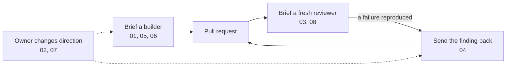

# Process material

How the work was run, in its own words: eight of the briefs given to the coding and review agents, and the sources of three explainer pages made along the way. Nothing here is needed to run the project.

## Briefs

Every agent was briefed the same way: the goal and why, the context it could not see, the bar for done and the hard rules. Never the steps ([`AGENTS.md`](../../AGENTS.md#briefing-another-agent)).

| File | Sent (UTC) | To | What it shows |
|---|---|---|---|
| [`01-build-the-pilot-catalogue.md`](briefs/01-build-the-pilot-catalogue.md) | 18 Nov, 23:42 | A new builder | The first build brief: a 14-game pilot before the full catalogue. Leads to #10 |
| [`02-cut-the-rules-to-nine-pieces.md`](briefs/02-cut-the-rules-to-nine-pieces.md) | 19 Nov, 00:21 | The agent writing the working rules | The owner rejecting a 37-item rule set for nine pieces. The rejected output the README describes |
| [`03-review-the-catalogue-by-breaking-it.md`](briefs/03-review-the-catalogue-by-breaking-it.md) | 19 Nov, 01:04 | A new reviewer | A review brief: no author's reasoning, one command per failure. Reviews #10 |
| [`04-send-the-findings-back-for-a-fix.md`](briefs/04-send-the-findings-back-for-a-fix.md) | 19 Nov, 01:18 | The catalogue's builder | Four reproduced findings going back, each with why it matters |
| [`05-build-the-pipeline.md`](briefs/05-build-the-pipeline.md) | 19 Nov, 20:30 | A new builder | The brief behind #11 |
| [`06-build-the-service-evaluation-and-console.md`](briefs/06-build-the-service-evaluation-and-console.md) | 19 Nov, 20:55 | A new builder | The brief behind #12 |
| [`07-reverse-the-rule-on-tag-conflicts.md`](briefs/07-reverse-the-rule-on-tag-conflicts.md) | 19 Nov, 21:17 | The pipeline's builder | The owner reversing a cautious rule that threw away 17 correct labels |
| [`08-review-the-service-by-breaking-it.md`](briefs/08-review-the-service-by-breaking-it.md) | 19 Nov, 21:34 | A new reviewer | A review brief with a separate judgement asked on the evaluation's honesty. Reviews #12 |

**What was done to them.** Each file is the brief as sent, with private details removed: paths on the owner's machine, the command that loads the API key there, the name of a private agent profile, the role applied for, and the sentences that describe how the assignment is sized and assessed or follow its wording closely. Every removal is marked in place as `[cut: …]`, 26 in all, and nothing else was changed. Numbers in a brief are the ones known when it was sent.

**What is not here.** This is a selection. The session sent many more messages than these, most of them short follow-ups. The briefs for the research and planning before the build are left out: several describe the owner's other work, and cleaning those would leave little.

## Explainer pages

Three pages written for the owner during the build, to make a decision or to show progress. Each is one self-contained HTML file: open it in a browser.

| Source | What it is | Hosted copy |
|---|---|---|
| [`pages/catalogue.html`](pages/catalogue.html) | How one game is planned, written and damaged, and every kind of mess counted | <https://because-you-played-status.vercel.app/catalogue> |
| [`pages/evaluation.html`](pages/evaluation.html) | The four evaluation decisions as they were put to the owner, with sliders for the pass marks, before any result existed | <https://because-you-played-status.vercel.app/evaluation> |
| [`pages/build-status.html`](pages/build-status.html) | The build's stages and what checking had caught, as of the time printed at its top | <https://because-you-played-status.vercel.app/>, locked while the repository was private |

- **They are snapshots.** Each says what was true when it was written and was not updated afterwards. The evaluation page's label counts include the four duplicate rows, as it says at its foot, so they are not the evaluation's totals. Current figures are in [`docs/features/`](../features/) and in the files `npm run eval` writes.
- **The hosted copies are a convenience.** The product itself runs locally: see the [README](../../README.md).
- The sources are as written, with two changes. A variable in the evaluation page's script was renamed, because the secret scan took the name of a browser-storage entry for a key. One sentence of the status page was corrected: it said the catalogue's review found three things and all were fixed, where that pull request records four findings. They load their fonts from Google Fonts and nothing else from the network.
