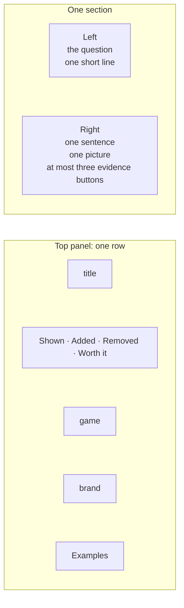

# UI and UX guidelines

What the page is for, what it puts on screen and what it keeps back, how it behaves, and the tokens and components it is built from. The aim is that an agent can change the page from this file alone.

**Status.** This file describes the page as it is built: one page, four sections, one on screen at a time. The look is the one the owner chose: near-black with green. Whether it is signed off has one home, the **Status** line of [`docs/features/interface.md`](features/interface.md), which also holds the behaviour that can be proved (UI-1 to UI-22). Nothing checks these guidelines by machine, except where a section names the check that does.

## What the page is for

It is the inspection view of a recommender, not the screen a player would see. A visitor has about two minutes and has never seen the project. In that time the page has to answer four questions, each at a glance, with the evidence one press away and never in the way.

## One section, one question

The page was first a single long column that showed everything it knew. It was true and nobody could read it. The rule now:

| | Budget | What does not go there |
|---|---|---|
| Top panel | The title, the four tabs, the game and brand pickers, Examples. One row on a desktop | The version picker (it is where versions are discussed), the status of the service (at the foot) |
| Left | The question, as a question, and one short line under it | A note about the example, a kicker, a second paragraph |
| Right | One sentence that answers the question. One picture. At most three buttons, each named for the evidence it opens | Legends, footnotes and caveat boxes. A legend is part of the picture or a hover. Anything else goes behind a button |
| Foot | What the page is and is not, which version is served, and that every value comes from the service's own responses | |

| Section | The question | The sentence | The picture |
|---|---|---|---|
| 1 · Shown | A player has just played *game* on *brand*. What should they be shown next? | What the service returns, and what that guarantees | The games, closest first, each with what it has in common with the game played |
| 2 · Added | Suppliers send thin, messy records. Can a model fill in what is missing without inventing anything? | What the lookup table found and what the version holds, read from the record | What the supplier sent beside what the version holds; the text with the words marked |
| 3 · Removed | Out of *n* games, why these? What was removed, and in what order? | How many are shown, and how many the rules removed before anything was scored | One flow across the width, a number at each step; a step opens what it removed |
| 4 · Worth it | The model costs money. Does it rank related games better than plain code, and by how much? | Which version is served, against the best version built without the model, with the cost of each | The four versions as one comparison, with one line on what the numbers cannot show |

**A boxed note appears on the surface only when the request calls for it:** a decline, a failure the evaluation found for the request on screen, a version shown for comparison, a game an address points at, an address the page could not read.

**Thinning must not turn a qualified statement into an unqualified one.** When a qualifier leaves the surface, the sentence that stays has to be true on its own. "Scored above the similarity floor and are live there" is what the service guarantees, so it stays; "related" is not, so it is not said. The one line under the comparison stays because without it the numbers would read as more than they are.

**Nothing true is deleted; it is one press away.** Every score, the raw record, the steps of enrichment with model and prompt names, the per-version comparison, the timings, the pass marks, the what-if sliders, the failures and the limits are each behind a button whose name says what it opens. There is no "show details".

**A section fills the window it is given, and is checked.** On a desktop the question sits in the middle of the left column, and the rows, the steps, the comparison and the type are sized from the height of the window, up to a limit. In a desktop window at least 560px high the page is a frame the size of the window and never scrolls. Two things that can be long give way first and scroll inside their own box: the supplier's text, and what an open step removed. At 1366 by 768 and at 1288 by 650 nothing else scrolls, for the landing page and every example, in all four sections. On a phone the top panel, the question and the answering sentence are on screen on arrival, and the rest scrolls; nothing is hidden to force one screen. `node tools/console-check.ts` fails when either stops being true ([UI-13, UI-21, UI-22](features/interface.md#invariants)). The page never scrolls itself.

## Principles

1. **One question at a time.** See above.
2. **Show the system's own data.** Every value comes from this service's responses (UI-1). The page computes no score, no label and no verdict. What it adds is reading and drawing: a bar as long as a number, a count of a list, a quote marked where it sits, the labels two records both hold, the overlap of two lists, and a search of the responses for a game that shows something.
3. **Claim only what was measured.**
   - A returned game scored above the similarity floor and is live on the brand. It is not called related (UI-15).
   - What a result has in common with the game played is worded as what they share, never as the cause of its score (UI-9).
   - A different list from another version is not called a better one. "Better" rests only on the evaluation's numbers (UI-10).
   - The similarity floor is a point in the spread of scores, not evidence that a player would find a result relevant (UI-11).
   - A sentence about what the lookup table or the model found is read from the record, never a fixed line (UI-16).
   - A failure is shown on the request it happened on, and nowhere else (UI-17).
   - A cost is an estimate and reads as one (UI-10).
   - The split by the condition of the record is not offered as the model's work on those records, and the limits are the plan's own (UI-20).
4. **Evidence sits in the text itself.** A label carries a number, and the same number sits on the words it was read from.
5. **A picture before a paragraph.** A bar always has its number beside it, starts at zero, and is as long as its number from the first frame.
6. **Round for reading, exact on request.** A score is shown to two places with the number as returned one hover or focus away, and in the evidence. Counts appear beside any rate in the evidence.
7. **A decline is an outcome, not an error.** It shows its reason and no results (UI-2). It is amber, never red.
8. **Colour carries meaning and never carries it alone.** A coloured label always has words.
9. **One badge style, used sparingly.** At most one or two on a section: "result", "served", "declined".
10. **Calm.** Flat panels and thin rules. Motion only to show where a section came from, once, and none for a reader who asked for less.

## Colour tokens

Colours are CSS custom properties on the root element, in `src/console/styles.css`. Components use the tokens and never a literal colour. The UI library's own variables (`--ui-*`) are pointed at these tokens there, so its parts wear this look.

| Token | Value | Used for |
|---|---|---|
| `--bg` | `#090c0a` | Page background, the evidence sheet, the text of the Examples button |
| `--panel` | `#0f1411` | A panel: a result, a card, a step, a picker, a callout |
| `--panel-2` | `#141b17` | A fill inside a panel: an open step, the marker of the open tab, a plain tag |
| `--line` | `#1b2620` | Rules between rows, and the empty part of a bar |
| `--line-strong` | `#2b3b33` | The border of a card, a step, the tabs, a sheet or a neutral label |
| `--edge` | `#5f7468` | The border of a control: a picker, an evidence button |
| `--text` | `#e4ede7` | Text, and a tick on a bar or a slider |
| `--muted` | `#8fa197` | Secondary text, table headings, small labels |
| `--green` | `#35d07f` | Kept: a result, the served version, what is shown, a pass. The Examples button |
| `--mint` | `#a8f0c6` | Links, the focus ring, the game played in the question, a number that joins a label to its words |
| `--amber` | `#e8b44a` | Caution: declined, removed, a failure the evaluation found, a moved pass mark, exploration only |
| `--red` | `#f0806f` | Failure: a failed pass mark, an error |
| `--blue` | `#7fb6e8` | The model: a label it asserted, the words it quoted |
| `--green-deep` `#123524`, `--amber-deep` `#3a2c0f`, `--red-deep` `#3d1a15`, `--blue-deep` `#14283a` | | The fill behind a label of that colour |

Anything that is not one of these meanings is text or muted. A label from the synonym table is plain, so that blue means the model and nothing else; a hover on a label says which it is.

**One look.** There is no light theme: the page declares `color-scheme: dark` whatever the system setting. Because every component reads the tokens, a second theme would be a second set of values on the root.

**Measured contrast.** WCAG 2 contrast ratios, computed from the values above. Small text needs 4.5 and the edge of a control 3.

| Text on background | Ratio |
|---|---|
| `--text` on `--bg` / `--panel` / `--panel-2` | 16.44 / 15.57 / 14.65 |
| `--muted` on `--bg` / `--panel` / `--panel-2` | 7.22 / 6.83 / 6.43 |
| `--green` on `--bg` / `--panel` / `--green-deep` | 9.81 / 9.29 / 6.72 |
| `--bg` on `--green` (the Examples button) | 9.81 |
| `--mint` on `--bg` / `--panel` / `--green-deep` | 14.92 / 14.13 / 10.22 |
| `--amber` on `--bg` / `--panel` / `--amber-deep` | 10.35 / 9.80 / 7.15 |
| `--red` on `--bg` / `--panel` / `--red-deep` | 7.51 / 7.11 / 5.91 |
| `--blue` on `--bg` / `--panel` / `--blue-deep` | 9.13 / 8.65 / 7.00 |
| `--text` on `--blue-deep` | 12.60 |
| `--mint` / `--green` / `--amber` / `--blue` on `--panel-2` | 13.30 / 8.74 / 9.22 / 8.14 |
| `--edge` on `--bg` / `--panel` | 3.92 / 3.71 |
| `--line-strong` on `--bg` | 1.66 |
| `--line` on `--bg` | 1.26 |

`--line` and `--line-strong` are far below 3, so they only separate things and never carry a meaning alone. Amber and red are close for some readers, and so are green and amber. That is why a status is always a word.

## Type

No web fonts: the page loads nothing a fresh clone does not hold. One typeface for prose.

- **Display:** `"Avenir Next", "Segoe UI", system-ui, sans-serif`, weight 700. The title, the question, the large figures.
- **Body:** `system-ui, -apple-system, "Segoe UI", Helvetica, Arial, sans-serif`. Everything that is read as a sentence, and every control.
- **Mono:** `ui-monospace, "SF Mono", SFMono-Regular, Menlo, Consolas, monospace`. Only a label tag, an id, a quoted phrase or a reason code: things a machine wrote.

| Role | Stack | Size | Used for |
|---|---|---|---|
| Question | Display | From the window's height on a desktop, 21 to 48px; about 19px on a phone | The one `h2` of a section. The game played is in `--mint` |
| Answering sentence | Body | 16 to 26px with the window's height | The first thing on the right |
| Large figure | Display | With the window's height | The count on a step, the rate of a version, the rank of a result |
| Body | Body | 16px, line height 1.5 | Everything else, and all evidence |
| Small | Body | 13.6px, `--muted` | The line under the question, a provider, a note |
| Badge | Body | 10.6px, upper case, in a pill | A state: result, served, declined, pass, fail |
| Tag | Mono | 12.5px, in a 3px box | A theme or a mechanic, or a tag as the supplier sent it |
| Figures | any | `font-variant-numeric: tabular-nums` | Every score, count and rate |

Sizes are set in `rem` or from the window, never in fixed pixels, so the reader's own text size applies.

## Layout

- **Desktop, 900px and wider.** The top panel is one row (two rows between 900 and 1100px). Under it the section takes the rest of the window: the question in a column about a third wide, the answer in the rest. Every section's answer follows the same column, so switching tabs moves nothing but the content. The page is as wide as 90% of the window, between 1272 and 1720px.
- **Phone, under 900px.** The title and Examples on the first row, the tabs on the second, the pickers on the third. Then the question, the sentence and the picture in one column. The flow of steps wraps to four across.
- **The evidence sheet** comes from the right on a desktop and from the bottom on a phone, over a dimmed page. Its body scrolls as a whole. A wide table scrolls inside its own box, and the page never scrolls sideways, down to 320px.
- Panels are flat fills with no shadow. Radii are small, 3 to 6px; tabs, buttons and badges are pills.

## Components

`@ui-sdk/react` gives the behaviour (focus, keyboard, dismissal, ARIA) and this page gives the look. Where a part is a library component it is named.

| Component | What it is | Notes |
|---|---|---|
| Tabs | UI SDK `Tabs`: four tabs, numbered, with a marker that slides to the open one | Arrow keys move between tabs. The address follows the open tab |
| Marker of the open tab | A pill behind the tab, wrapped in `metal-fx` | Without WebGL2 it is the plain pill |
| Game picker | UI SDK `Select` with a search field and its list | Opening it lists every game at once, scrollable, positioned on the chosen one; typing narrows. The closed control shows the title alone; the status on the brand and the state of the record are beside each title in the open list |
| Brand picker | UI SDK `Select` | |
| Version picker | UI SDK `Select`, inside "This request in every version of the index" | Any version but the served one puts a boxed note on each section, with a button back |
| Examples | The one filled button on the page, in `--green`, wrapped in `metal-fx`; it opens a UI SDK `Popover` with one link per example and a line on what it shows in the game found | Found by asking the service, never named in the code. An example the data does not hold is dashed and says none was found. The open one is outlined, there and nowhere else |
| Answering sentence | The first thing on the right | For a decline: an amber box, "the service recommends nothing, and says why", the reason, and the reason code |
| Result | A row: rank, title and provider, "in common" with tags, and the score to two places | UI SDK `Tooltip` on the score holds the exact score, the floor, and that the order cannot be traced to single labels |
| Cards | "The supplier sent" beside "*version* holds", then the supplier's text with marks | A supplier tag is plain, struck through when it is not about the game, dashed when the table does not know it, amber when the description contradicts it. A label whose words cannot be found says so, never silently |
| Flow | UI SDK `Accordion` laid out as one row: the catalogue, one button per filter in the trace's order, and what is shown | Each step says which of three things it decides (rule, score, limit), the count left, and how many it removed. One step is open at a time; its box says what kind of decision it is and lists what it removed with the trace's reason |
| Comparison | A table, a row per version: name and how it was built, rate, a UI SDK `Meter` bar from zero with a tick at the pass mark, estimated cost | The served version is in green and badged. A version that fails a pass mark says so in words |
| Evidence button | A pill with the border of a control | Its text is the title of what it opens |
| Evidence sheet | UI SDK `Drawer` | Escape or Close returns focus to the button that opened it. A larger piece is a UI SDK `Accordion` of named parts, the first open |
| What-if | Inside the release gate's evidence: the statement that the gate reads only the committed file, what would ship with the marks now set, then one UI SDK `Slider` per pass mark | The committed mark is a fixed tick on each slider. A moved mark turns its thumb amber and says "moved" |
| Callout | A panel with a coloured left rule | Only for the cases listed under [One section, one question](#one-section-one-question) |
| Badge | Upper-case words in a pill | The words are the meaning |

## Motion

| What moves | How | Why |
|---|---|---|
| A section | Fades and slides 28px from the side its tab is on, in about 0.3s | It shows which way the reader moved |
| The marker of the open tab | Slides to the tab, 0.42s | The same |
| The liquid-metal ring | A slow shimmer on the marker and on Examples | The only motion that repeats. It is on two controls and on no data |
| Rows and steps | Rise 8px once, at full opacity | A row is never faint or half-drawn: it must not look disabled |
| The sheet, a popover | Slide or scale in | They come from somewhere |

A bar never animates: it is as long as its number from the first frame. With `prefers-reduced-motion: reduce` every animation and transition is off, the metal effect is still, and the page is complete without them. Nothing in the what-if panel animates.

## States

| State | When | What the reader sees |
|---|---|---|
| Landing | No request in the address | The first example, opened on "Shown" |
| Loading | A request is in flight | The word "Loading" where the answer will appear. No spinner |
| Result | The service returned results | The sentence and the games |
| Declined | The service declined | The decline in the place of the results, with its reason. The other sections say what did not run |
| Comparison | A version other than the served one is chosen | A boxed note on each section naming the version, and the button back |
| Empty | No example could be found and nothing is chosen | One sentence asking for a choice |
| Bad address | The address names something the page does not know | A boxed note saying exactly what, above the section; nothing is replaced in silence |
| Bad input | The service rejected the request | An amber "bad request" label and what was wrong, in a sentence |
| Failed | The request did not complete | A red "failed" label, what happened, and that nothing is shown because nothing was received |
| No WebGL2 | The browser cannot draw the metal effect | The same page without the ring |
| No JavaScript | The script did not run | The title and one sentence saying what the page is and that it needs JavaScript |

An error is never shown as an empty result, and an empty result is never shown as an error.

## Accessibility basics

- **Structure.** One `h1`, one `h2` per section, a real `table` for tabular data, a `tablist` with `tab` and `tabpanel`, a dialog for the sheet. `lang` is set on the root element.
- **Keyboard.** Everything works from the keyboard: arrow keys between tabs, Enter or Space on a step or a button, Escape to close a sheet, a picker or the examples, arrow keys on a slider. Focus returns to the control that opened a sheet.
- **Focus.** A 2px `--mint` outline on anything focusable, never removed, including the two controls the metal effect wraps.
- **Labels.** Every picker has a name. A step is a button whose `aria-expanded` says whether its list is open. A bar has a name and a value.
- **Contrast.** Only the pairings measured above.
- **Meaning.** Colour is never the only signal.
- **Motion.** See [Motion](#motion).

## What only the owner judges

The look and feel of the page is judged by the owner, who looks at it ([What is the owner's](../AGENTS.md#what-is-the-owners), [`REVIEW.md`](../REVIEW.md)). A change to how the page looks is done only when the owner has signed it off.

What a reader sees first, on one screen and without help, is not look. It is behaviour, and an agent checks it in a browser at a fixed window size. An agent shows what can be shown by running something, and reports the rest as not verified. An agent does not write that the page looks good, clear or finished.
